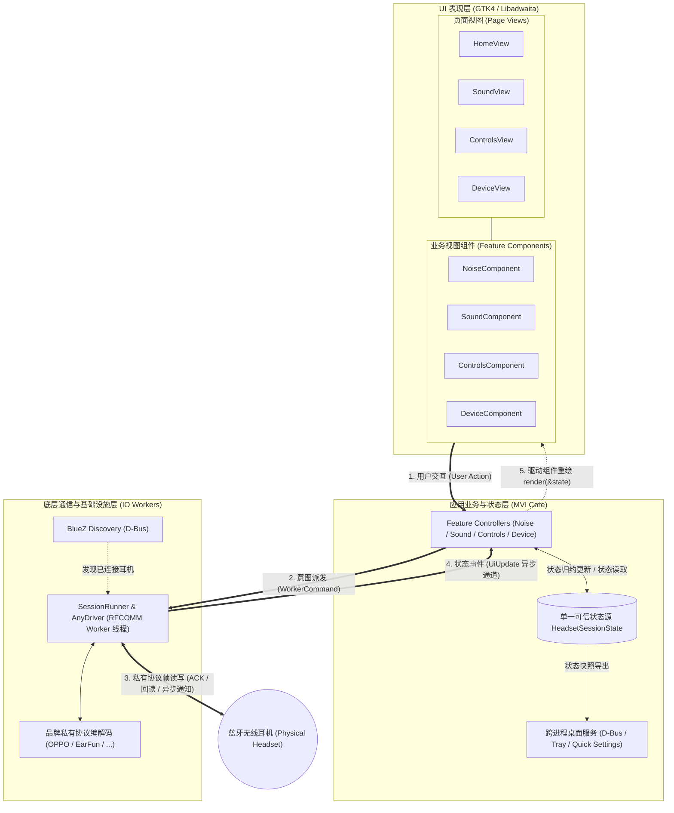

# WaveTune 软件架构与分层设计规范

本文档为 WaveTune 项目的核心架构规范，基于轻量 MVI（Model-View-Intent）与垂直切片（Feature-First）模式建立，指导系统的分层组织、状态管理、异步事件流及功能扩展。

---

## 一、 整体架构蓝图

WaveTune 遵循**单向数据流（Unidirectional Data Flow, UDF）**与**分层隔离**原则，自底向上划分为三层：



---

## 二、 核心架构原则

### 1. 单一可信状态源（Single Source of Truth）
- 全局业务与设备状态统一收敛于 [`src/app/state.rs`](file:///home/onlymash/Projects/WaveTune/src/app/state.rs) 中的 `HeadsetSessionState`；
- 禁止在控制器或视图中维护散落的业务状态变量，所有视图数据均派生自中心状态；
- 设备断开时，通过 `state.reset_on_disconnect()` 统一重置状态树。

### 2. 单向数据流（Unidirectional Data Flow）
数据流动的闭环严格遵循：
1. **用户交互**：用户触发界面控件，`FeatureComponent` 触发对应 `connect_*` 回调；
2. **意图派发**：`FeatureController` 将交互转换为强类型 `WorkerCommand`，经由通道发往后台 IO 线程；
3. **后台执行**：底层蓝牙工作线程（RFCOMM Worker）执行私有协议编解码，等待耳机 ACK 与回读；
4. **事件产生**：工作线程通过异步通道向主线程抛出强类型的 `UiUpdate` 枚举；
5. **状态归约**：主线程事件循环捕获 `UiUpdate`，更新 `HeadsetSessionState` 对应字段；
6. **视图渲染**：控制器调用 `component.render(&state)`，组件内部执行纯粹的数据到 UI 映射。

### 3. 原生事件驱动（Event-Driven Loop）
- 严禁使用基于定时器（如 `glib::timeout_add_local`）的周期性轮询来读取消息；
- 采用 `async_channel`（或 `glib::MainContext::channel`）将后台线程与 GTK 主上下文无缝桥接，在 `gtk::glib::spawn_future_local` 中通过异步 `recv().await` 实现零 CPU 闲置开销的即时事件响应。

---

## 三、 垂直业务切片设计标准 (Feature Slice Standard)

所有业务特性均按垂直切片（Feature-First）组织在 [`src/app/features/`](file:///home/onlymash/Projects/WaveTune/src/app/features/) 目录下：

```text
src/app/features/
├── mod.rs                  # FeatureContext 定义
├── noise/                  # 降噪特性切片
│   ├── mod.rs
│   ├── component.rs        # NoiseComponent（视图组件）
│   └── controller.rs       # NoiseController（事件绑定与状态响应）
├── sound/                  # 声音特性切片（EQ、空间音频、游戏模式等）
├── controls/               # 控制特性切片（手势、头部动作、偏好设置）
└── device/                 # 设备特性切片（设备切换、固件、配对管理）
```

### 1. 结构化执行上下文 (`FeatureContext`)
每个 Feature Controller 初始化时持有轻量的 `FeatureContext`：
```rust
#[derive(Clone)]
pub(crate) struct FeatureContext {
    pub worker_commands: Rc<RefCell<Option<mpsc::Sender<WorkerCommand>>>>,
    pub updates_tx: mpsc::Sender<UiUpdate>,
    pub session_state: Rc<RefCell<HeadsetSessionState>>,
}
```
上下文提供安全的命令发送方法 `send_command(&self, cmd)` 与状态更新辅助方法。

### 2. Feature Component 职责规范
- **所有权**：持有该特性所关联的高内聚子组件（如 `QuickNoiseWidgets`）；
- **纯渲染映射**：提供 `pub fn render(&self, state: &FeatureState)` 方法，仅依据传入的状态参数更新控件展示；
- **防重入封闭**：组件内部自持 `ReentrancyFlag`，渲染前获取守卫 `let _guard = flag.enter()`，确保代码更新不触发反向用户事件。

### 3. Feature Controller 职责规范
- **事件绑定**：实现 `pub fn bind_events(&self)`，将子组件暴露的语义回调转换为 `WorkerCommand` 派发给 Worker；
- **更新响应**：实现 `pub fn on_update(&self, update: &UiUpdate) -> bool`，只处理属于自身业务领域的 `UiUpdate` 变体，更新对应的子状态并触发重绘。

---

## 四、 页面与 UI 控件规范

页面装配与子组件封装须严格遵守 [`docs/UI_COMPONENT_GUIDELINES.md`](UI_COMPONENT_GUIDELINES.md)：
1. **主页面纯胶水装配**：`build_*_page` 行数严格控制在百行以内，仅负责容器组装与子组件调用；
2. **控件私有化**：各功能卡片结构体（`*Widgets`）的所有原生 GTK 控件字段**一律私有**，外部仅能通过领域语义方法（如 `render()`、`update_*()`、`reset()`）交互；
3. **测试接口隔离**：测试检查器统一归入 `#[cfg(test)] impl *Widgets`，生产环境严禁直接透传原生控件句柄。

---

## 五、 底层通信与协议安全底线

遵循 [`AGENTS.md`](file:///home/onlymash/Projects/WaveTune/AGENTS.md) 与 [`docs/OPPO_BLUETOOTH_API.md`](OPPO_BLUETOOTH_API.md) 的安全约束：
1. **单指令写管道（Single Command Write Pipeline）**：
   写操作必须严格遵循“校验配置能力 $\to$ 发送单条指令 $\to$ 等待设备 ACK $\to$ 回读验证状态”的安全流程，禁止批量无序下发指令；
2. **未知设备只读保护**：
   产品 ID（Product ID）未在设备库声明的模型保持严格只读，禁止尝试写入；
3. **隐私绝对保护**：
   - 蓝牙物理地址（MAC）、设备序列号（SN）严禁日志输出或磁盘持久化；
   - 仅在内存状态中为配对设备操作临时保留，退出会话立即彻底清除；
4. **严禁固件写入**：
   本软件严禁包含任何 OTA、固件刷写或可能导致硬件损坏的操作。

---

## 六、 多品牌驱动扩展规范 (Multi-Brand Driver Architecture)

底层蓝牙通信遵循统一的驱动抽象规范：
1. **通用驱动抽象 (`HeadsetDriver`)**：
   各品牌实现统一的驱动接口，隔离底层会话细节；
2. **通用会话执行器 (`SessionRunner`)**：
   统一管理底层 RFCOMM 线程、超时、异常捕获及 UI 状态推送，彻底杜绝跨品牌重复实现 Worker 循环；
3. **统一分发工厂 (`create_driver`)**：
   通过 `AnyDriver` 实现品牌静态分发，新品牌接入流程与代码模板详见 [`docs/NEW_BRAND_INTEGRATION_GUIDE.md`](NEW_BRAND_INTEGRATION_GUIDE.md)。


