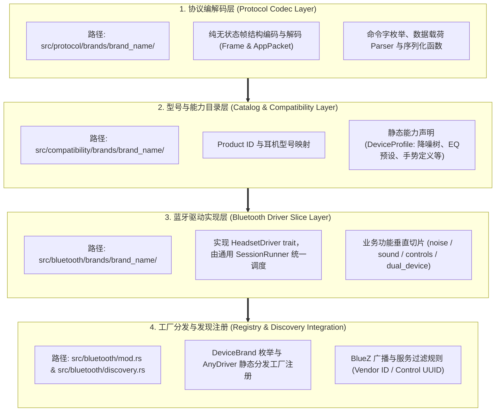

# WaveTune 新品牌耳机接入指南与开发标准 (New Brand SOP)

本文档为 WaveTune 跨品牌无线耳机控制架构的标准化接入指南（Standard Operating Procedure）。任何新耳机品牌（如华为 FreeBuds、小米 Buds、漫步者 Edifier、索尼 Sony 等）的接入均须遵循本文档所定义的模块划分、分层隔离准则与单指令安全写管道。

---

## 一、 整体接入架构概览

WaveTune 采用**品牌命名空间隔离**与**垂直切片架构**，新增一个耳机品牌涉及以下四个层次的实现：



> [!IMPORTANT]
> 接入新品牌时，**完全无需修改** UI 表现层（GTK4/Libadwaita）、MVI 核心状态层（`HeadsetSessionState`）、D-Bus 服务、托盘服务与 `SessionRunner` 线程执行器。只需按规范实现上述四层，新品牌即可自动获得全部桌面控制能力。

---

## 二、 步骤详解与代码模板

### 步骤 1：协议编解码层实现 (`src/protocol/brands/<brand>/`)

本层只关注二进制协议的封包、拆包与解析，必须遵循**纯无状态函数**与**参数对象化**设计：
- **严格禁止依赖其他层**：严禁引入任何 `crate::compatibility`、`crate::bluetooth` 或 GTK 依赖；
- **纯函数设计**：输入字节/DTO $\to$ 输出结构体/字节，禁止在协议中判断特定机型是否支持某功能；
- **参数对象化 (DTO)**：多于 3 个参数的复杂指令编解码必须封装为强类型 DTO，禁止散装参数。

#### 1. 垂直领域目录结构
遵循与业务领域对齐的垂直拆分，单文件代码规模控制在 200 行左右：
```text
src/protocol/brands/<brand>/
├── mod.rs               # 导出公共协议类型，保持接口整洁
├── codec.rs             # 帧同步头、转义处理、校验和与 FrameDecoder 增量解码器
├── commands.rs          # 命令字常量、事件 ID 与协议枚举
├── noise.rs             # 降噪与通透模式纯编解码
├── sound.rs             # EQ、自定义 EQ、空间音频、游戏模式等编解码（使用 DTO）
├── controls.rs          # 按键手势、贴合度检测、提示音量、头部动作等编解码
├── device.rs            # 电池电量、固件版本、机身颜色、配对设备列表等解析
└── tests.rs             # 协议纯编解码单元测试（Mock 报文输入输出比对）
```

#### 2. DTO 封装规范示例
当协议控制需要多个字段（如自定义 EQ、按键设置、频段增益）时，在 `src/protocol/core/types.rs` 或协议模块内定义 DTO：
```rust
// 强类型 DTO 封装复杂参数，拒绝散装参数
pub struct CustomEqualizerParams<'a> {
    pub id: u8,
    pub name: &'a str,
    pub min_gain: i8,
    pub max_gain: i8,
    pub bands: &'a [i8],
}

pub fn encode_custom_equalizer(action: CustomEqualizerAction, params: &CustomEqualizerParams<'_>) -> Vec<u8>;
```

#### 3. FrameDecoder 规范模板
耳机通过 RFCOMM Socket 传输的数据是流式字节，必须实现增量解析器以应对粘包与半包：

```rust
// src/protocol/brands/<brand>/codec.rs
#[derive(Default)]
pub struct CustomFrameDecoder {
    buffer: Vec<u8>,
}

impl CustomFrameDecoder {
    /// 接收流式字节，返回解析出的完整帧列表
    pub fn push(&mut self, bytes: &[u8]) -> Result<Vec<Vec<u8>>, String> {
        self.buffer.extend_from_slice(bytes);
        let mut frames = Vec::new();
        
        while let Some((frame, consumed)) = Self::extract_next_frame(&self.buffer)? {
            frames.push(frame);
            self.buffer.drain(..consumed);
        }
        
        // 限制未处理缓冲区最大容量，防止恶意或异常数据导致内存泄漏
        if self.buffer.len() > 4096 {
            self.buffer.clear();
        }
        
        Ok(frames)
    }

    fn extract_next_frame(buf: &[u8]) -> Result<Option<(Vec<u8>, usize)>, String> {
        // 实现帧头定位、长度校验、校验和 (CRC/Checksum) 验证
        todo!()
    }
}
```

---

### 步骤 2：型号与能力目录层 (`src/compatibility/brands/<brand>/`)

声明该品牌受支持的具体型号与其功能开关。未在此声明的设备将作为未知型号，由系统强制锁定为**只读模式**以保护硬件安全。
所有品牌私有的数据与单测必须内聚在该目录下，不得污染顶级 `src/compatibility/mod.rs`。

#### 1. 目录结构
```text
src/compatibility/brands/<brand>/
├── mod.rs               # 导出该品牌 Profiles、EQ 表、手势表
├── catalog.rs           # 声明具体型号的 DeviceProfile
├── equalizer.rs         # 品牌专属的硬件 EQ / 软件 EQ 预设表（可选）
├── gestures.rs          # 品牌专属的手势行定义（可选）
└── tests.rs             # 品牌所有型号能力的覆盖度断言与回归测试
```

#### 2. DeviceProfile 声明模板
```rust
// src/compatibility/brands/<brand>/catalog.rs
use crate::compatibility::{features, DeviceProfile, NoiseMode, NoiseModeKind};

pub const BRAND_MODEL_1_PID: u32 = 0x123456;

static MODEL_1_NOISE_MODES: &[NoiseMode] = &[
    NoiseMode { index: 0, kind: NoiseModeKind::Off, parent: None },
    NoiseMode { index: 1, kind: NoiseModeKind::NoiseCancelling, parent: None },
    NoiseMode { index: 2, kind: NoiseModeKind::Transparency, parent: None },
];

pub static BRAND_PROFILES: &[DeviceProfile] = &[
    DeviceProfile {
        product_id: Some(BRAND_MODEL_1_PID),
        model: "Example Earbuds Pro",
        features: &[
            features::DUAL_DEVICE,
            features::WEAR_DETECTION,
            features::EQUALIZER,
        ],
        noise_modes: MODEL_1_NOISE_MODES,
    },
];
```

并在 `src/compatibility/registry.rs` 的全局型号查询中加入新品牌列表。

#### 3. 品牌测试隔离 (`tests.rs`)
该品牌所有型号的能力断言与全量遍历测试必须放在 `src/compatibility/brands/<brand>/tests.rs`：
```rust
#[cfg(test)]
mod tests {
    use super::*;

    #[test]
    fn brand_models_coverage_and_capabilities() {
        for profile in BRAND_PROFILES {
            // 断言噪声模式 parent 索引闭包、特性组合合法性等
        }
    }
}
```

---

### 步骤 3：蓝牙驱动实现层 (`src/bluetooth/brands/<brand>/`)

按垂直切片实现新品牌的 `HeadsetDriver`，并通过执行上下文与领域子状态模式消除参数膨胀。

#### 1. 标准切片结构
```text
src/bluetooth/brands/<brand>/
├── mod.rs               # 导出 BrandDriver 及构造方法
├── driver.rs            # 实现 HeadsetDriver trait（仅调度与状态持有）
├── init.rs              # 握手、版本读取、组装初始 DeviceSnapshot
├── transport.rs         # RFCOMM 连接建立、Candidate UUIDs、单指令 request()
├── unsolicited.rs       # 处理设备主动广播通知（如开盖、出入耳、电量广播）
└── features/            # 垂直功能写管道（单一职责）
    ├── mod.rs           # 定义 BrandFeatureContext 及领域子状态结构体
    ├── noise.rs         # 降噪写指令、佩戴检查门控、回读确认
    ├── sound.rs         # EQ 调节、游戏模式、低音、编解码器配置
    ├── controls.rs      # 手势定制、入耳检测开关、提示音量等
    └── dual_device.rs   # 双设备多点连接管理与设备列表读写
```

#### 2. 特性上下文与领域子状态模式 (`features/mod.rs`)
严禁在驱动处理函数中传递 10~20 个分散参数。必须定义上下文与子状态：
```rust
// src/bluetooth/brands/<brand>/features/mod.rs
pub struct BrandFeatureContext<'a, T: Read + Write> {
    pub stream: &'a mut T,
    pub decoder: &'a mut CustomFrameDecoder,
    pub updates: &'a Sender<UiUpdate>,
    pub read_only: bool,
    pub profile: Option<&'static DeviceProfile>,
}

#[derive(Default)]
pub struct BrandControlsState {
    pub key_functions: Vec<KeyFunction>,
    pub in_ear_detection: Option<bool>,
}

#[derive(Default)]
pub struct BrandSoundState {
    pub custom_equalizers: Vec<CustomEqualizer>,
}
```

#### 3. HeadsetDriver 驱动实现模板
每个特性处理函数的参数严格控制在 2～3 个，避免 `clippy::too_many_arguments`：
```rust
// src/bluetooth/brands/<brand>/driver.rs
use std::{fs::File, io::{Read, Write}, sync::mpsc::Sender, time::Duration};
use crate::{
    app::events::{UiUpdate, WorkerCommand},
    bluetooth::{DeviceChoice, DeviceSnapshot, driver::HeadsetDriver},
    compatibility::DeviceProfile,
};
use super::features::{BrandControlsState, BrandFeatureContext, BrandSoundState};

pub struct BrandDriver {
    decoder: CustomFrameDecoder,
    read_only: bool,
    profile: Option<&'static DeviceProfile>,
    pub sound: BrandSoundState,
    pub controls: BrandControlsState,
}

impl HeadsetDriver for BrandDriver {
    fn brand_name(&self) -> &'static str {
        "brand_name"
    }

    fn open_rfcomm(&mut self, device: &DeviceChoice) -> std::io::Result<File> {
        super::transport::open_brand_rfcomm(device)
    }

    fn initialize<T: Read + Write>(
        &mut self,
        stream: &mut T,
        device: &DeviceChoice,
        updates: Option<&Sender<UiUpdate>>,
    ) -> Result<DeviceSnapshot, String> {
        let (snapshot, decoder) = super::init::initialize_brand_session(stream, device, updates)?;
        self.decoder = decoder;
        self.read_only = snapshot.identity.read_only;
        // 初始化领域子状态
        Ok(snapshot)
    }

    fn handle_command<T: Read + Write>(
        &mut self,
        stream: &mut T,
        command: WorkerCommand,
        updates: &Sender<UiUpdate>,
    ) -> Result<(), String> {
        let mut ctx = BrandFeatureContext {
            stream,
            decoder: &mut self.decoder,
            updates,
            read_only: self.read_only,
            profile: self.profile,
        };

        // 委托给对应的 features::* 切片处理，参数数量控制在 2~3 个
        if super::features::noise::handle_noise_command(&mut ctx, &command) {
            return Ok(());
        }
        if super::features::sound::handle_sound_command(&mut ctx, &command, &mut self.sound) {
            return Ok(());
        }
        if super::features::controls::handle_controls_command(&mut ctx, &command, &mut self.controls) {
            return Ok(());
        }

        Ok(())
    }

    fn handle_incoming_bytes<T: Read + Write>(
        &mut self,
        stream: &mut T,
        bytes: &[u8],
        updates: &Sender<UiUpdate>,
    ) -> Result<(), String> {
        let frames = self.decoder.push(bytes).map_err(|e| e.to_string())?;
        for frame in frames {
            super::unsolicited::handle_unsolicited(stream, &frame, updates);
        }
        Ok(())
    }

    fn poll_interval(&self) -> Option<Duration> {
        None
    }
}
```
```

---

### 步骤 4：工厂分发与发现注册

#### 1. 扩展 `DeviceBrand` 枚举
在 [`src/protocol/core/types.rs`](file:///home/onlymash/Projects/WaveTune/src/protocol/core/types.rs) 中添加新品牌枚举变体：
```rust
pub enum DeviceBrand {
    OnePlus,
    Oppo,
    Realme,
    EarFun,
    NewBrand, // 新增
}
```

#### 2. 在驱动分发中心注册
在 [`src/bluetooth/mod.rs`](file:///home/onlymash/Projects/WaveTune/src/bluetooth/mod.rs) 中的 `AnyDriver` 枚举与 `create_driver` 工厂中加入分支：

```rust
pub enum AnyDriver {
    EarFun(brands::earfun::EarFunDriver),
    Oppo(brands::oppo::OppoDriver),
    NewBrand(brands::new_brand::NewBrandDriver), // 新增变体并转发 Trait 方法
}

pub fn create_driver(brand: DeviceBrand) -> AnyDriver {
    match brand {
        DeviceBrand::EarFun => AnyDriver::EarFun(brands::earfun::EarFunDriver::new()),
        DeviceBrand::NewBrand => AnyDriver::NewBrand(brands::new_brand::NewBrandDriver::new()),
        DeviceBrand::OnePlus | DeviceBrand::Oppo | DeviceBrand::Realme => {
            AnyDriver::Oppo(brands::oppo::OppoDriver::new())
        }
    }
}
```

#### 3. 注册 BlueZ 发现规则
在 [`src/bluetooth/discovery.rs`](file:///home/onlymash/Projects/WaveTune/src/bluetooth/discovery.rs) 中：
- 注册该品牌的 Bluetooth SIG Company Identifier（厂商 ID）或专有控制服务 UUID；
- 确保系统启动或蓝牙扫描时能自动识别该品牌耳机并指派对应的 `DeviceBrand`。

---

## 三、 安全红线与开发质量检查清单

在提交新品牌代码合并前，必须逐项核对并满足以下安全红线：

- [ ] **单指令写管道（Single Command Write Pipeline）**：
  - 严禁并发或连续无间隔下发写指令；
  - 写入流程必须严格为：`校验能力 -> 发送指令 -> 等待硬件 ACK -> 发送读取指令回读验证`；
  - 若回读状态不匹配或超时，必须向 UI 抛出 `UiUpdate::SettingError`，维持界面原有确认状态。
- [ ] **未知设备只读隔离**：
  - 未在 `catalog.rs` 注册的 Product ID，其快照必须设置 `read_only: true`；
  - 只读设备阻断所有写指令，仅允许查询或被动接收电量/固件信息。
- [ ] **隐私保护与无残留**：
  - 终端控制台、日志（`println!`, `eprintln!`, `tracing`）中**严禁打印物理 MAC 地址、设备序列号（SN）**；
  - 双设备管理中所读取的配对设备 MAC，仅在内存快照中供用户界面操作使用，会话断开后立即丢弃，严禁落盘。
- [ ] **严禁任何固件写操作**：
  - 绝对严禁实现固件升级（OTA）、擦写存储器或未公开工程调试命令。
- [ ] **协议纯净性与零反向依赖**：
  - 协议层必须为纯无状态编解码器，检查 `rg "compatibility" src/protocol/brands/<brand>/` 命中数必须为 0；
  - 协议层严禁导入 `DeviceProfile` 或在编解码时做硬件机型支持性逻辑判定；
  - 多参数编解码必须封装为强类型 DTO（如 `CustomEqualizerParams`、`NoiseCycleSetting` 等）。
- [ ] **参数收敛与无参数爆炸**：
  - 驱动层命令派发必须采用 `<Brand>FeatureContext` 与领域子状态模式；
  - 指令处理函数参数控制在 2～3 个，严禁引入 `#[allow(clippy::too_many_arguments)]`。
- [ ] **兼容层隔离与单测归位**：
  - 品牌专属手势、EQ 预设及全型号测试必须放置于 `src/compatibility/brands/<brand>/` 下；
  - 严禁将品牌私有型号覆盖断言直接写在顶级 `src/compatibility/mod.rs`。
- [ ] **国际化覆盖**：
  - UI 抛出的状态提示必须在 `locales/` 的 Fluent 文件中定义，控制台调试信息保持纯英文。
- [ ] **测试覆盖与代码格式**：
  - 针对该协议编写完整的 MockStream 单元测试；
  - 确保 `cargo fmt --check`、`cargo check --locked` 与 `cargo test --locked` 100% 绿色通过。

