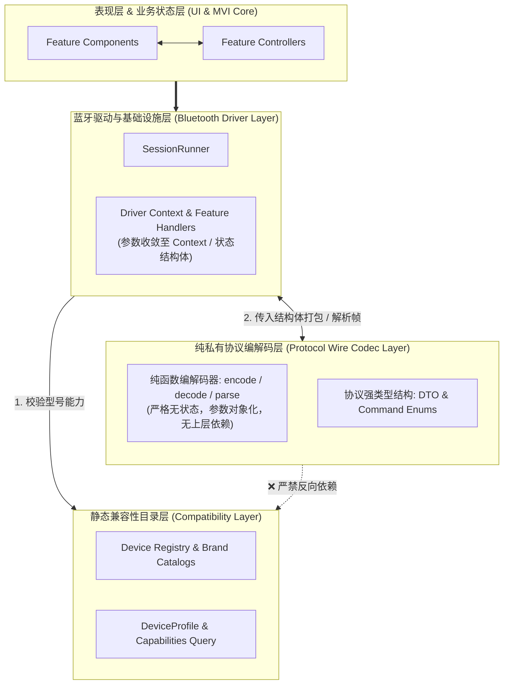

# WaveTune 协议层 (Protocol) 与兼容层 (Compatibility) 架构重构方案

本文档针对 WaveTune 项目中 `src/protocol`、`src/compatibility` 以及驱动接口层的现存技术债务与代码异味，拟定全面的模块拆解与强类型重构方案。

---

## 一、 背景与重构动因

在完成 `app`（MVI/Controller/State）、`bluetooth`（Driver/SessionRunner）与 `ui`（Component/Widgets/Private）的模块化重构后，系统上层与核心调度流已建立起清晰的单向数据流与生命周期隔离。

然而，审查当前底层通信与数据模型实现，发现存在显著的技术债务与设计缺陷：

1. **基本类型偏执与参数膨胀 (Primitive Obsession & Parameter Creep)**：
   - 协议编解码层存在大量松散的基本类型参数（如自定义 EQ 编解码函数接收 6 个散装参数，手势设置接收 4 个散装参数）；
   - 该问题向上蔓延至蓝牙驱动层，导致 [`handle_controls_command`](file:///home/onlymash/Projects/WaveTune/src/bluetooth/brands/oppo/features/controls.rs#L33) 出现了 **21 个参数的“参数怪物”函数**，被迫标注 `#[allow(clippy::too_many_arguments)]`。
2. **架构分层倒置 (Layer Violation)**：
   - [`src/protocol/brands/oppo/oppo_noise.rs`](file:///home/onlymash/Projects/WaveTune/src/protocol/brands/oppo/oppo_noise.rs#L20) 直接 `use crate::compatibility;`，且其内部函数通过 `product_id` 反查上层设备配置。
   - 协议层（底层纯编解码器）反向依赖了上层兼容配置（型号目录），破坏了底层无状态与纯净性。
3. **单文件职责杂糅 (Monolithic & Mixed Responsibilities)**：
   - [`oppo_parsers.rs`](file:///home/onlymash/Projects/WaveTune/src/protocol/brands/oppo/oppo_parsers.rs)（612 行）名不副实，既包含 10 余种数据包的解析（Parsers），又混杂了按键、EQ、贴合度、音量等操作的编码（Encoders）；
   - [`compatibility/mod.rs`](file:///home/onlymash/Projects/WaveTune/src/compatibility/mod.rs)（752 行）除了声明公共 trait 与结构体外，硬编码了 OPPO 专属的手势映射模板，并混入了近 300 行仅针对 OPPO 131 款机型特性的专有单元测试。
4. **历史双重别名过渡残留 (Legacy Port Aliases)**：
   - [`src/protocol/brands/oppo/mod.rs`](file:///home/onlymash/Projects/WaveTune/src/protocol/brands/oppo/mod.rs) 中几乎为每个函数和类型都导出了 `oppo_*` 和无前缀两份别名（如 `AppPacket` / `OppoAppPacket`、`parse_battery_event` / `parse_oppo_battery_event`），增加了认知负担与维护冗余。

---

## 二、 架构重构目标与核心原则



### 1. 协议纯净化（Pure Wire Codec）
- 协议编解码函数必须是**纯函数**：入参为结构化对象或字节切片，出参为字节向量或解析后的领域结构体；
- 彻底斩断 Protocol 对 Compatibility 的反向依赖，协议层严禁接受 `product_id` 或反查设备 profile。

### 2. 强类型化与对象参数化（Parameter Objects）
- 坚决杜绝 3 个以上松散基础类型的函数参数；
- 凡具有领域内聚性的参数（如 EQ 频段、手势按键动作、自定义 EQ 指令），必须封装为强类型枚举或结构体。

### 3. 垂直切片对齐（Feature-First in Protocol）
- 按照 `noise`、`sound`、`controls`、`device` 等业务切片组织协议编解码文件，解析器（Parser）与编码器（Encoder）按业务成对归放。

### 4. 驱动层上下文收敛（Driver Context Pattern）
- 蓝牙驱动的特性处理器使用结构化上下文（`Context`）或直接绑定至 `Driver` 内部方法，消除 14~21 个散装参数的坏味道。

---

## 三、 详细重构设计

### 1. 协议层（`src/protocol`）重构设计

#### (1) 引入强类型 DTO 与命令枚举，消除散装参数

##### A. 自定义均衡器指令封装
**重构前**：
```rust
pub fn encode_oppo_custom_equalizer_command(
    action: u8,
    id: u8,
    name: &str,
    min_gain: i8,
    max_gain: i8,
    bands: &[(u16, i8)],
) -> Vec<u8>
```
**重构后**：
```rust
#[derive(Debug, Clone, Copy, PartialEq, Eq)]
pub enum CustomEqualizerAction {
    Create = 0x01,
    Update = 0x02,
    Delete = 0x03,
}

pub fn encode_oppo_custom_equalizer(
    action: CustomEqualizerAction,
    equalizer: &CustomEqualizer,
) -> Vec<u8>
```

##### B. 按键手势配置指令封装
**重构前**：
```rust
pub fn encode_oppo_set_key_function(
    side: EarSide,
    button: u8,
    action: GestureAction,
    function: u8,
) -> Vec<u8>
```
**重构后**：
```rust
// 直接复用领域类型 KeyFunction，0 个冗余参数
pub fn encode_oppo_set_key_function(key_function: &KeyFunction) -> Vec<u8>
```

##### C. 降噪轮换与频段参数封装
**重构后新增 DTO**：
```rust
#[derive(Debug, Clone, Copy, PartialEq, Eq)]
pub struct NoiseCycleSetting {
    pub side: EarSide,
    pub mask: u32,
    pub is_shared: bool,
}

pub fn encode_oppo_set_noise_cycle(setting: &NoiseCycleSetting) -> Vec<u8>;

pub struct GaiaEqBand {
    pub band_id: u8,
    pub frequency: u16,
    pub q_factor: u16,
    pub gain_db: f64,
}

pub fn encode_earfun_eq_band(band: &GaiaEqBand) -> Vec<u8>;
```

#### (2) 目录结构垂直解耦（消除 `oppo_parsers.rs` 大杂烩）

将 `src/protocol/brands/oppo/` 重构为：
```text
src/protocol/brands/oppo/
├── mod.rs               # 模块统一清晰导出（清理双重别名）
├── codec.rs             # 帧同步、转义与分片 (合并原 oppo_frame.rs 与 oppo_packet.rs)
├── commands.rs          # 协议命令字与事件 ID 常量 (原 oppo_commands.rs)
├── capabilities.rs      # 运行时协议能力掩码解析 (原 oppo_capabilities.rs)
├── noise.rs             # 降噪与通透模式纯编解码（去除 compatibility 依赖）
├── sound.rs             # EQ、空间音频、游戏模式、低音增强、自定义 EQ 编解码
├── controls.rs          # 手势按键、贴合度检测、提示音量、头部动作编解码
├── device.rs            # 电池电量、固件版本、机身颜色、配对设备列表编解码
└── tests.rs             # 协议单元测试集
```

#### (3) 剥离 `oppo_noise.rs` 中的 Compatibility 依赖

- **删除函数**：`oppo_noise_mode_write_payload_for_product(product_id: u32, ...)` 与 `oppo_noise_mode_readback_matches_for_product`；
- **保留并纯化协议函数**：
  ```rust
  /// 将协议降噪索引编码为下发报文载荷（纯无状态函数）
  pub fn encode_oppo_noise_mode(protocol_index: u8) -> Vec<u8> {
      let byte_count = usize::from(protocol_index / 8) + 1;
      let mut payload = vec![1, 1];
      payload.resize(2 + byte_count, 0);
      payload[2 + usize::from(protocol_index / 8)] = 1 << (protocol_index % 8);
      payload
  }

  /// 从设备响应报文中解析降噪索引
  pub fn parse_oppo_noise_mode_response(payload: &[u8]) -> Option<u8>;
  ```
- 模式是否被当前耳机型号支持、回读比对规则归回 `compatibility` 或 driver 处理。

---

### 2. 蓝牙驱动层（`src/bluetooth`）参数收敛设计

治理 `OppoDriver` 派发子函数 21 个参数的问题：

#### 重构方式：聚合驱动上下文（Driver Context）
在 `src/bluetooth/brands/oppo/features/` 中定义特性上下文结构体，或将方法绑定至 `OppoDriver`：

```rust
pub struct OppoFeatureContext<'a, T: Read + Write> {
    pub stream: &'a mut T,
    pub decoder: &'a mut FrameDecoder,
    pub updates: &'a Sender<UiUpdate>,
    pub read_only: bool,
    pub profile: Option<&'static DeviceProfile>,
}

// 驱动处理函数参数从 21 个缩减至 3 个：
pub fn handle_controls_command<T: Read + Write>(
    ctx: &mut OppoFeatureContext<'_, T>,
    state: &mut OppoControlsDriverState,
    command: &WorkerCommand,
) -> bool;
```
同时将 `OppoDriver` 中零散的 20 余个字段按领域聚合：
```rust
pub struct OppoControlsDriverState {
    pub current_key_functions: Vec<KeyFunction>,
    pub current_noise_cycle: NoiseCycleState,
    pub is_finding_earbuds: bool,
    pub current_prompt_volume: Option<u8>,
    pub current_head_motion: Option<u8>,
    pub current_in_ear_detection: Option<bool>,
    pub current_sleep_detection: Option<bool>,
    pub current_wear: WearState,
}
```

---

### 3. 兼容层（`src/compatibility`）重构设计

#### (1) 模块职责净化
- **手势模板迁移**：将 [`STANDARD_GESTURE_ROWS`](file:///home/onlymash/Projects/WaveTune/src/compatibility/mod.rs#L180) 移入 `compatibility/brands/oppo/`，通过函数或 trait 提供接入，避免顶级模块包含品牌专有数据；
- **单测隔离**：将 `src/compatibility/mod.rs` 底部的 300 行 OPPO 专属型号断言单元测试移入 `src/compatibility/brands/oppo/tests.rs`；
- **保持顶级模块纯粹**：`src/compatibility/mod.rs` 仅保留 `DeviceProfile`、`NoiseMode`、`EqualizerPreset`、`features` 常量表以及通用的能力判定方法。

---

## 四、 分阶段实施计划 (Implementation Roadmap)

| 阶段 | 实施任务 | 关键产出 / 验证标准 |
| :--- | :--- | :--- |
| **Phase 1** | **参数对象化与 DTO 引入**<br>1. 定义 `CustomEqualizerAction`、`NoiseCycleSetting`、`GaiaEqBand`。<br>2. 重构 `encode_oppo_custom_equalizer`、`encode_oppo_set_key_function` 等编码函数签名。<br>3. 适配已有调用方与单元测试。 | `cargo test --locked` 120 个测试全部通过；消除散装参数。 |
| **Phase 2** | **斩断 Protocol 对 Compatibility 依赖**<br>1. 移除 `oppo_noise.rs` 中的 `use crate::compatibility;`。<br>2. 调整调用链，将 profile 查询上提至 driver 层。<br>3. 验证降噪协议单元测试。 | 协议层不含任何 `crate::compatibility` 引用。 |
| **Phase 3** | **Protocol 模块垂直拆分与别名清理**<br>1. 将 `oppo_parsers.rs` 拆分为 `sound.rs`、`controls.rs`、`device.rs`、`codec.rs`。<br>2. 清理 `src/protocol/brands/oppo/mod.rs` 的双重别名。<br>3. 保持向外部暴露干净的统一接口。 | 单个协议文件规模降至 200 行以内，功能内聚。 |
| **Phase 4** | **蓝牙驱动层处理函数参数收敛**<br>1. 引入 `OppoFeatureContext` 与特性子状态结构体。<br>2. 重构 `handle_controls_command`、`handle_sound_command` 等函数。<br>3. 移除 `#[allow(clippy::too_many_arguments)]` 标注。 | 驱动层无任何超过 5 个参数的函数，Clippy 零警告。 |
| **Phase 5** | **Compatibility 模块净化与单元测试归位**<br>1. 迁移 `STANDARD_GESTURE_ROWS` 至 `compatibility/brands/oppo/`。<br>2. 迁移 OPPO 专有机型单元测试至品牌测试目录。<br>3. 运行完整测试与格式化检查。 | `cargo fmt --check`、`cargo clippy`、`cargo test` 全绿。 |

---

## 五、 风险控制与验证标准

1. **零功能回退保障**：
   - 本重构属于**内部纯重构（Pure Refactoring）**，不改变任何对外协议数据格式与蓝牙握手行为；
   - 依赖现有 120 个覆盖完整的单元测试（包含电池、降噪、EQ、手势、防重入、D-Bus 等），每一步重构均实时执行 `cargo test --locked` 确保零回归。
2. **硬件安全约束**：
   - 严格维持 `AGENTS.md` 中的安全底线：未知设备保持只读保护、单指令写管道、严禁批量无序下发或固件写入。

