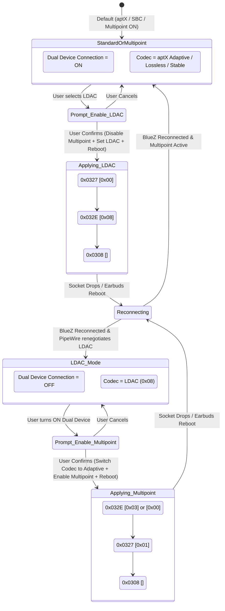

# EarFun Wireless Headset Control Protocol (GAIA and EF Variants)

This document records the private control protocols used by EarFun wireless headphones and earbuds. It covers the existing GAIA V3 support (including the **EarFun Air Pro 4**, **EarFun Air S**, and **EarFun Free Pro 3**) and newer GAIA/EF model information analyzed from the local EncoDeck source, including the **EarFun Air Pro 4+**.

The GAIA models use Qualcomm GAIA-family frames over Bluetooth Classic RFCOMM/SPP; the newer EF models use a separate `0xEF` frame format. The frame families and model-specific command maps are not interchangeable. This document distinguishes hardware-tested facts from client-source-derived behavior. Hardware-validation status records evidence only; it is not an additional gate for exposing features on models in WaveTune's predefined compatibility catalog. For a registered model, the profile's declared capabilities determine which implemented controls are available. Runtime safety preconditions and missing protocol/feature implementations still apply.

Reference implementations and hardware validation:
- **Client Reference**: Freeyourgadget / Gadgetbridge (PR #4635 / commit `d9d0573812`, `cab12149d6`, `1473364031`).
- **Hardware Validation**: Tested live on real **EarFun Air Pro 4** (Hardware/Firmware `TW600-3091_20250919_v0.4.1`, Product ID `45 35`, connected to Arch Linux via RFCOMM channel 11).
- **Additional Client Reference**: EncoDeck local source revision `f893e15` (EarFun protocol implementation); its source attributes model/protocol facts to EarKit commit `a77acd18890a5f28746c2303bfff0e23fff8d8ca` (MIT). EncoDeck's compatibility notes say further real-device feedback is pending.

---

## 1. Bluetooth Connection and Discovery

### 1.1 Bluetooth Identity and SDP Records
EarFun devices advertise standard Bluetooth Classic audio and serial profiles:

- **Device Name**: `EarFun Air Pro 4`, `EarFun Air S`, `EarFun Free Pro 3`, etc.
- **Bluetooth Class**: `0x00240404` (Audio / Headset)
- **Manufacturer Vendor ID**: `0x5A70` (`23152`).
  - Manufacturer Specific Data in BLE/EIR advertisement carries `[0x70, 0x5A, ...]`.
  - Format includes the lower 4 bytes of the device MAC address followed by the 2-byte **Product ID**.
  - **Product IDs**:
    - **EarFun Air Pro 4**: `[0x45, 0x35]` (`0x004535`, ASCII `"E5"`)
    - **EarFun Free Pro 3**: `[0x45, 0x34]` (`0x004534`, ASCII `"E4"`)
    - **EarFun Air S**: `[0x4C, 0x45]` (`0x004C45`, ASCII `"LE"`)
- **Service UUIDs**:
  - Standard SPP UUID: `00001101-0000-1000-8000-00805F9B34FB`
  - Qualcomm GAIA UUID: `00001107-D102-11E1-9B23-00025B00A5A5`
  - Vendor Specific UUIDs: `0000eb04-d102-11e1-9b23-00025b00a5a5` ... `eb07`; WaveTune recognizes these for EarFun/GAIA routing and avoids EF probing. They are not used as RFCOMM service candidates; channel lookup preserves the discovered control-service candidate list and falls back to the GAIA UUID (`0x1107`) only when BlueZ reports no candidates.
- **RFCOMM Channel**:
  - Live probe on EarFun Air Pro 4 confirms that **RFCOMM Channel 11** accepts the GAIA control connection.
  - (Channel 22 is also exposed for raw diagnostic/telemetry streams).

### 1.2 Product ID and Model Identification Architecture
WaveTune strictly enforces that Bluetooth device names and user aliases are display-only and never used as a logic filter or product discriminator.

EarFun hardware identification resolves through two objective hardware-level mechanisms:
1. **Bluetooth Manufacturer Specific Data (`0x5A70`)**:
   During BlueZ discovery, if the device advertises `0x5A70`, the Product ID is extracted by matching the device MAC address suffix within the data payload:
   - `0x45, 0x35` $\to$ Product ID `0x004535` (EarFun Air Pro 4)
   - `0x45, 0x34` $\to$ Product ID `0x004534` (EarFun Free Pro 3)
   - `0x4C, 0x45` $\to$ Product ID `0x004C45` (EarFun Air S)
2. **RFCOMM Firmware Hardware Project Code (`0x0309`)**:
   When connecting over Bluetooth Classic without retained BLE advertising data, querying `0x0309` returns the vendor firmware string:
   - Starts with `TW600` (e.g., `TW600-3091_...`) $\to$ Product ID `0x004535` (Air Pro 4)
   - Starts with `TW400` / `TW400B` $\to$ Product ID `0x004534` (Free Pro 3)
   - Starts with `TW201` $\to$ Product ID `0x004C45` (Air S)
   - The returned firmware string is also used directly as a model identity when no registered numeric Product ID exists. Current GAIA profile prefixes include `TW700AI`, `TW700`, `TW800`, `TW500_3072`, `TW500`, `TWA01`, `ATVEL_TW201`, `TW101S`, and `HP1000`. A prefix must be followed by `-`, `_`, or end-of-string; the profile code is not treated as a numeric manufacturer Product ID.
3. **Safety Fallback**:
   If neither source identifies a recognized Product ID, the session enters safe **Read-Only Mode** (`is_known_model: false`, `read_only: true`), displaying `Unknown Model` and disabling all control writes.

### 1.3 Additional model identifiers in EncoDeck

The current EncoDeck EarFun profile table contains 23 model records. The identifiers below are EncoDeck profile IDs; they are not necessarily firmware project codes. EncoDeck selects a profile using the Bluetooth device name, then reads firmware. Its source does not establish a numeric manufacturer Product ID for the new models.

| EncoDeck profile ID(s) | EncoDeck model name(s) | Protocol family / behavior variant |
|---|---|---|
| `TW600` | EarFun Air Pro 4 | GAIA / `tw600` |
| `TW700` | EarFun Air Pro 4+; EarFun Air Pro 4+AI | GAIA / `tw700` |
| `TW800` | EarFun Air Pro 5 | GAIA / `tw700` behavior variant |
| `TW500`, `TW500_3072` | EarFun Air Pro 3; Air Pro 3 (3072) | GAIA / `qcc` |
| `TW400` | EarFun Free Pro 3 | GAIA / `qcc` |
| `TWA01`, `TW201` | EarFun Air S; Air S (TW201) | GAIA / `qcc` |
| `ATVEL_TW201` | ATVEL Tune S5 ProX | GAIA / `qcc` |
| `TW101S` | EarFun Free 2S | GAIA / `qcc` |
| `HP1000` | EarFun Wave Pro X | GAIA / `hp1000` |
| `TW220`, `TW220_VDL` | EarFun Air 2 NC; Air 2 NC (VDL) | EF / `ef` |
| `TW205` | EarFun Air Life | EF / `tw205` |
| `TW230` | EarFun Air Pro 4i | EF / `tw230` |
| `OW100`, `OW100_NEW` | EarFun OpenJump; OpenJump (new variant) | EF / `ef` |
| `CW100`, `CW200` | EarFun Clip; Clip 2 | EF / `cw100`, `cw200` |
| `HP201` | EarFun Wave Life | EF / `head` |
| `HP220` | EarFun Tune Pro | EF / `head` |
| `HP300` | EarFun Wave Pro 2 | EF / `head` |

This table reproduces EncoDeck's source profile IDs and names. WaveTune does not use `Named()` or any Bluetooth display name to select a model. After the GAIA firmware query succeeds, the exact returned firmware prefix selects a GAIA compatibility profile for the codes listed in Section 1.2; the model code remains separate from the numeric manufacturer Product ID, which is still unknown for these profiles. This path is source-derived and covered by synthetic tests, not by a new hardware capture.

WaveTune now has an EF frame codec, an EF bootstrap path, and compatibility entries for the EF IDs listed above. It tries to resolve an EF profile from the strict prefix of the `0x1010` firmware response, without consulting the Bluetooth display name. **EncoDeck itself selects these profiles by device name and does not establish that `0x1010` returns those model prefixes.** Therefore, this identity path is not independently confirmed: if the response does not contain a matching prefix, WaveTune keeps the EF session read-only rather than guessing a model. The entries are catalog configuration, not a hardware validation claim.

---

## 2. Frame Architecture

EarFun frames use the Qualcomm GAIA V3 frame layout without a checksum.

### 2.1 Packet Format

| Offset (Bytes) | Field | Value / Meaning |
|---|---|---|
| `0` | **SOP** | Start of Packet: constant `0xFF` |
| `1` | **Version** | Protocol version: `0x04` (request default) or `0x03` (earbuds response) |
| `2` | **Flags** | Bit 0: Checksum flag. Always `0x00` (checksum is not used) |
| `3` | **Length** | Payload byte length $N$ ($0 \le N \le 255$) |
| `4..5` | **Vendor ID** | Big-Endian 16-bit Vendor Identifier:<br>• `0x000A` (Qualcomm GAIA v1/v2 legacy / standard vendor)<br>• `0x001D` (Qualcomm GAIA v3 vendor) |
| `6..7` | **Command ID** | Big-Endian 16-bit Command Identifier |
| `8..8+N-1` | **Payload** | Command-specific payload |

### 2.2 Command ID Structure
Command IDs are 16-bit words formatted as:
```text
Bit 15      : ACK / Response flag (0x8000)
Bit 14..8   : Command Type (0x01: Config, 0x02: Control, 0x03: Status, 0x0E/0x0F: EQ, 0x40: Notification)
Bit 7..0    : Command Code
```

- When the host sends a request or setting command (e.g., `0x0306`), the earbuds respond with `Command ID | 0x8000` (e.g., `0x8306`).
- In EarFun responses, the first payload byte is typically a **Status Code** (`0x00` = Success / OK), followed by the reported value(s).

### 2.3 EF frame family (source-derived)

EncoDeck's non-GAIA profiles use a distinct frame format rather than the GAIA `0xFF` packet:

| Offset | Field |
|---|---|
| `0` | Start byte `0xEF` |
| `1..2` | Command ID, big-endian |
| `3` | Payload length `N` |
| `4..4+N-1` | Payload |
| `4+N` | Check byte: `(N + sum(payload)) & 0xFF` |
| `5+N` | End byte `0xFE` |

For these profiles, the inspected EncoDeck codec validates the additive check byte and `0xFE` terminator; response status/value semantics are command-specific and must not be assumed to match GAIA's leading status byte. WaveTune implements this as a separate incremental decoder with bounded frame length and checksum/terminator validation. EncoDeck maps EF commands by model/setting; see Section 4.11. This format and its model mappings are source-derived and have not been independently hardware-validated by WaveTune.

---

## 3. Session Initialization Sequence

When connecting over RFCOMM Channel 11, Gadgetbridge's Air Pro 4 and Free Pro 3 implementations perform the following handshake:

1. **Query Firmware Version**:
   - Host sends: `FF 04 00 00 00 0A 03 09`
   - Earbuds reply: `FF 03 00 1B 00 0A 83 09 [00] [UTF-8 String]`
   - Example response payload: `00 54 57 36 30 30 2D 33 30 39 31 5F 32 30 32 35 30 39 31 39 5F 76 30 2E 34 2E 31` (`"TW600-3091_20250919_v0.4.1"`).
2. **Query Battery Levels**:
   - Left Earbud: `0x0306`
   - Right Earbud: `0x0307`
   - Charging Case: `0x0317`
3. **Query Audio Experience / Sound Controls**:
   - Current Noise Control (Ambient Sound) Mode: `0x0315`
   - Active Noise Cancelling (ANC) Sub-Mode: `0x033B`
   - Transparency Sub-Mode: `0x033D`
   - Game Mode (Low Latency): `0x0313`
4. **Query System & Connectivity Settings**:
   - In-Ear Detection: `0x034A`
   - Dual Device Connection (Multipoint): `0x0326`
   - Touch Controls / Gestures: `0x030B`
   - Touch Lock Mode: `0x0335`
   - Audio Codec: `0x032F`
   - Voice Prompt Volume: `0x0339`
   - Microphone Mode: `0x0331`
   - Find Device: `0x0333`
   - This extended request set is used by Gadgetbridge's Air Pro 4 and Free Pro 3 protocol classes. Air S uses the shared basic request for earbud battery and touch gestures; do not infer support for these extended queries on Air S.

---

## 4. Commands and Payload Reference

### 4.1 Battery Status
| Feature | Command ID | Request Payload | Response ID | Response Payload | Description |
|---|---|---|---|---|---|
| Left Battery | `0x0306` | Empty (`[]`) | `0x8306` | `[00, level]` | `level`: 0–100 percentage |
| Right Battery | `0x0307` | Empty (`[]`) | `0x8307` | `[00, level]` | `level`: 0–100 percentage |
| Case Battery | `0x0317` | Empty (`[]`) | `0x8317` | `[00, level]` | `level`: 0–100 percentage (not supported on EarFun Air S) |

*Notes on Model Differences & Disconnected Case Behavior*:
- **EarFun Air Pro 4 & Free Pro 3**: Support 3 battery readings (Left, Right, Case).
- **EarFun Air S**: Only reports Left and Right battery levels (`0x0306`, `0x0307`). Querying Case Battery (`0x0317`) returns an error or times out, so case query is omitted for Air S.
- **Charging Case Offline Sentinel (`0xFF` / `255`)**:
  - When the earbuds are removed from the charging case, the case lid is closed, or the charging case is not in a physical communication state with the earbuds, the earbud chipset cannot read the case battery level. Querying the case battery (`0x0317`) returns `[0x00, 0xFF]` (decimal 255).
  - `0xFF` (255) is an unavailable/offline sentinel value (Unavailable / Disconnected). Clients parsing this response must detect and treat it as `None` or unreported; displaying `255%` directly in the UI is strictly invalid.
  - A reading is only considered a valid battery percentage when `0 <= level <= 100`.
- **Charging status**: The tested Air Pro 4 GAIA replies to `0x0306`, `0x0307`, and `0x0317` contain only a status byte and battery percentage. These commands do not report whether either earbud or the case is charging; WaveTune represents charging state as unknown instead of reporting false.

*Example (live tested)*:
- Request Left: `FF 04 00 00 00 0A 03 06` $\to$ Response: `FF 03 00 02 00 0A 83 06 00 5A` (90%)
- Request Right: `FF 04 00 00 00 0A 03 07` $\to$ Response: `FF 03 00 02 00 0A 83 07 00 64` (100%)
- Request Case: `FF 04 00 00 00 0A 03 17` $\to$ Response: `FF 03 00 02 00 0A 83 17 00 64` (100%)

---

### 4.2 Noise Control (Ambient Sound & ANC)

EarFun headsets handle noise control differently depending on model generation:
- **EarFun Air Pro 4 & Free Pro 3**: Split into **Master Ambient Mode** (`0x0314` / `0x0315`) and **Sub-Modes** (`0x033A`/`0x033B` for ANC, `0x033C`/`0x033D` for Transparency).
- **EarFun Air S**: Directly sets and queries Master Ambient Mode (`0x0314` / `0x0315`) with 3 flat states (`0` = Off, `1` = ANC, `2` = Transparency) without secondary sub-modes.

#### Master Mode (`0x0314` Set / `0x0315` Query)
- **Query**: `0x0315` (Response `0x8315 [00, mode]`)
- **Set**: `0x0314 [mode]` (Response `0x8314 [00]`)
- **Modes**:
  - `0`: **Normal (Off)**
  - `1`: **Noise Cancelling (ANC)**
  - `2`: **Ambient Sound (Transparency)**

#### ANC Sub-Modes (`0x033A` Set / `0x033B` Query)
When Master Mode is `1` (ANC), the active ANC algorithm is configured via `0x033A`:
- **Query**: `0x033B` (Response `0x833B [00, submode]`)
- **Set**: `0x033A [submode]`
- **Submodes**:
  - `0`: **AI Ear Adaptive**
  - `1`: **Wind Noise Cancelling**
  - `2`: **Strong ANC**
  - `3`: **Balanced ANC**
  - `4`: **AI Environment Adaptive**

#### Transparency Sub-Modes (`0x033C` Set / `0x033D` Query)
When Master Mode is `2` (Transparency):
- **Query**: `0x033D` (Response `0x833D [00, submode]`)
- **Set**: `0x033C [submode]`
- **Submodes**:
  - `0`: **Default**
  - `1`: **Natural**

#### WaveTune Noise-Mode Write Behavior
WaveTune preserves its original GAIA noise-mode sequence: send the master-mode command, wait 20 ms before a sub-mode command when needed, then drain incoming frames for up to 100 ms (50 ms for flat-mode profiles) so device events can be processed. It does not require a SET ACK or immediate GET readback for these noise writes; those requirements were removed because this operation must retain the existing EarFun-compatible command flow. The UI mode update is derived from the selected mode and cached sub-mode, then may be refreshed by the normal mode poll. This describes client behavior, not a claim that every model/firmware acknowledges or applies every command identically. The documented `0x034A` command reports whether the automatic in-ear detection setting is enabled, not the current physical wear state. No GAIA physical wear-state query/event is established in this API record, so WaveTune displays physical wear as unavailable and does not use that missing status to block noise controls.

---

### 4.3 Low Latency / Game Mode
- **Query**: `0x0313` $\to$ Response `0x8313 [00, 00|01]`
- **Set**: `0x0312 [00|01]` $\to$ Response `0x8312 [00]`
- Values: `0` = Disabled, `1` = Enabled.

---

### 4.4 In-Ear Detection Setting
- **Supported Models**: EarFun Air Pro 4 (Hardware-verified). EarFun Free Pro 3 and EarFun Air S do not have wear sensors and skip this setting.
- **Query**: `0x034A` $\to$ Response `0x834A [00, val]`
- **Set**: `0x0349 [val]` $\to$ Response `0x8349 [00]`
- Values: `0` = In-Ear Detection Enabled, `1` = Disabled.
- This setting controls whether automatic in-ear detection is enabled; it is not itself the current left/right wear state. No separate current-wear query or notification is established by the available GAIA evidence. WaveTune leaves physical wear unknown rather than infer it from an open RFCOMM connection; this unknown state does not disable noise controls.

---

### 4.5 Dual Device Connection (Multipoint)
- **Query**: `0x0326` $\to$ Response `0x8326 [00, 00|01]`
- **Set**: `0x0327 [00|01]`
- **Values**: `0` = Disabled, `1` = Enabled.
- **Packet Structure**:
  - Request Query: `FF 04 00 00 00 0A 03 26`
  - Response Query: `FF 03 00 02 00 0A 83 26 00 <00|01>`
  - Request Set: `FF 04 00 01 00 0A 03 27 <00|01>`
  - Response ACK: `FF 03 00 01 00 0A 83 27 00`
- **Reboot Requirement**:
  Setting dual-device mode requires the earbuds to reboot (`0x0308`, `COMMAND_REBOOT`) for the Qualcomm Bluetooth stack to re-initialize its ACL scheduling and multipoint manager. In Gadgetbridge, `SET_CONNECT_TWO_DEVICES` explicitly joins `0x0327` and `0x0308`.
- **Hardware Constraint on EarFun Air Pro 4**:
  Dual Device Connection and **LDAC** codec are **strictly mutually exclusive**. Enabling Dual Device Connection while LDAC is active automatically disables LDAC and switches to a standard/adaptive codec (aptX Adaptive or Stable Connection) before restarting the headset. See [Section 4.8](#48-reboot-command-and-ldac--multipoint-mutual-exclusivity) for details.

---

### 4.6 Graphic Equalizer (10-Band vs 6-Band)
EarFun headsets support hardware equalization using Qualcomm GAIA V3 non-standard extensions (`Vendor ID = 0x001D`).

- **Write Command**: `0x0E01` (Set Band Gain)
- **Response**: `0x0F81 [01]` (ACK returned for each band written)
- **Query Command (`0x0E02`) Status**: **Not Supported (`COMMAND_NOT_SUPPORTED`)**
- **Gain Encoding**:
  - GAIA uses a factor of 60 for 1 dB. EarFun maps $\pm 6 \text{ dB}$ over a slider scale of $\pm 10$.
  - Formula: $\text{gain\_raw} = \text{round}(\text{gain\_val} \times 60 \times 0.6) = \text{round}(\text{gain\_val} \times 36)$.
- **Payload Format (9 bytes per band)**:
  ```text
  Byte 0   : Band ID (0xA1 .. 0xAA)
  Byte 1..2: Filter Type / Config (0xFF, 0x98)
  Byte 3..4: Frequency in Hz (16-bit Big-Endian)
  Byte 5..6: Gain (16-bit signed Big-Endian)
  Byte 7..8: Q-Factor (16-bit Big-Endian)
  ```

#### Write-Only Characteristics & Architecture Differences
1. **No Hardware Preset Concept**:
   - Unlike OPPO/OnePlus headsets which feature a firmware-level preset manager queried via `0x010F` (`CMD_GET_EQUALIZER`), EarFun headsets operate at the raw Qualcomm Kymera DSP PEQ (Parametric Equalizer) filter layer.
   - The headset firmware does not know what "Classic" or "Bass Boost" is; it only receives and stores raw DSP filter coefficients.
2. **Query Attempt (`0x0E02`) Rejected**:
   - Live probing with `0x0E02` (`REQUEST_RESPONSE_EQUALIZER_CONFIG`) across multiple payload variants (empty, band ID `0xA1`, `0x00`, `0x01`) consistently triggers the GAIA error frame:
     `FF 03 00 01 00 1D 0F 82 01` (`0x0F82` is `0x0E02 | 0x0180` error flag, payload `0x01` = `STATUS_NOT_SUPPORTED`).
   - The headset does not provide a mechanism to read back active PEQ coefficients from the DSP registers.
3. **Client-Side State Tracking & Persistence**:
   - Both the official EarFun companion app and Gadgetbridge maintain preset definitions and active preset states entirely within client-side local storage (`SharedPreferences` in Android).
   - In WaveTune, the selected preset is persisted in `~/.config/wavetune/settings.ini` under an anonymous device key derived from the SHA-256 hash of the device MAC (`[Device_{PID}_{SHA256(MAC)[..12]}]`). This guarantees uniqueness across multiple headsets of the same model without persisting or exposing raw Bluetooth addresses.
   - On session establishment, WaveTune checks if a non-default preset was previously active and automatically synchronizes the 10-band DSP parameters to the earbud, ensuring consistent audio reproduction even after headset power cycles.

#### 10-Band Models (EarFun Air Pro 4 & Free Pro 3):
| Band | Band ID | Frequency (Hz) | Q-Factor |
|---|---|---|---|
| 1 | `0xA1` | 31.5 Hz (`0x005E`) | `0x0B33` |
| 2 | `0xA2` | 63 Hz (`0x00BD`) | `0x0B33` |
| 3 | `0xA3` | 125 Hz (`0x0177`) | `0x0B33` |
| 4 | `0xA4` | 250 Hz (`0x02EE`) | `0x0B33` |
| 5 | `0xA5` | 500 Hz (`0x05DC`) | `0x0B33` |
| 6 | `0xA6` | 1000 Hz (`0x0BB8`) | `0x0B33` |
| 7 | `0xA7` | 2000 Hz (`0x1770`) | `0x0B33` |
| 8 | `0xA8` | 4000 Hz (`0x2EE0`) | `0x0B33` |
| 9 | `0xA9` | 8000 Hz (`0x5DC0`) | `0x0B33` |
| 10 | `0xAA` | 16000 Hz (`0xBB80`) | `0x0B33` |

#### 6-Band Models (EarFun Air S):
The EarFun Air S uses 6 active EQ frequency bands (60 Hz, 150 Hz, 400 Hz, 1000 Hz, 3000 Hz, 8000 Hz).
However, the GAIA protocol expects all 10 bands to be sent. Bands 7–10 are dummy bands populated with fixed default values (frequencies 31.5 Hz, 63 Hz, 125 Hz, 250 Hz, Q-Factor `0x0B33`, Gain 0 dB) as specified in Gadgetbridge's `Equalizer.java`.

---

### 4.7 Audio Codec Selection & Audio Modes

EarFun exposes audio codec selection and audio mode configuration via GAIA V1/V2 legacy commands (`Vendor ID = 0x000A`).

#### 4.7.1 Audio Codec Query and Configuration
- **Query Command**: `0x032F` (`REQUEST_RESPONSE_AUDIO_CODEC`)
  - Request: `FF 04 00 00 00 0A 03 2F` (no payload)
  - Response: `FF 03 00 02 00 0A 83 2F 00 <codec>`
  - First payload byte is Status Code `0x00` (Success); second byte is current active codec index.
- **Set Command**: `0x032E` (`SET_AUDIO_CODEC`)
  - Request: `FF 04 00 01 00 0A 03 2E <codec>`
  - Response ACK: `FF 03 00 01 00 0A 83 2E 00`
- **Reboot Dependency**:
  Setting `0x032E` modifies the Bluetooth firmware audio endpoint configuration. **The headset requires a reboot (`0x0308`) immediately after applying the new codec** to allow the Qualcomm SoC to re-initialize its DSP pipeline and re-negotiate A2DP capabilities with the host (Linux BlueZ / PipeWire).

#### 4.7.2 Codec Values and Model Support Matrix

| Codec Index (Dec / Hex) | Name / Profile | Description | EarFun Air Pro 4 (`0x004535`) | EarFun Free Pro 3 (`0x004534`) | EarFun Air S (`0x004C45`) |
|---|---|---|:---:|:---:|:---:|
| `0` (`0x00`) | **Stable Connection** | Standard SBC / AAC connection prioritizing link stability and battery life | Supported | Supported | A2DP Auto Only |
| `1` (`0x01`) | **aptX** | Standard Qualcomm aptX low-latency audio | Supported | Supported | A2DP Auto Only |
| `3` (`0x03`) | **aptX Adaptive** | Dynamic bitrate adjustment (279–420 kbps) based on RF quality | Supported | Supported | Unsupported |
| `19` (`0x13`) | **aptX Adaptive Lossless** | Qualcomm Snapdragon Sound CD-quality lossless (16-bit/44.1 kHz to 24-bit/96 kHz) | Supported | Unsupported | Unsupported |
| `8` (`0x08`) | **LDAC** | Sony High-Resolution audio (up to 990 kbps @ 24-bit/96 kHz) | Supported | Unsupported | Unsupported |

*Model Differences*:
- **EarFun Air Pro 4 (QCC3091)**: Full codec menu (Stable, aptX, aptX Adaptive, aptX Lossless, LDAC).
- **EarFun Free Pro 3 (QCC5171/QCC3072)**: Only offers Stable Connection, aptX, and aptX Adaptive.
- **EarFun Air S (QCC3046)**: Does not expose `0x032E`/`0x032F` software switching in companion app or Gadgetbridge; codecs are negotiated automatically by the host operating system's Bluetooth A2DP stack.

#### 4.7.3 Related Audio Mode Commands
- **Runtime Audio Mode Status (`0x034D`)**:
  - Query / Unsolicited Notification: `0x034D` (`REQUEST_RESPONSE_AUDIO_MODE`)
  - Response: `0x834D [00, mode]`
  - Values observed:
    - `0x03`: Active when any aptX mode (aptX / aptX Adaptive / aptX Lossless) is engaged.
    - `0x02`: Active when Stable Connection (SBC/AAC) or LDAC is engaged.
    - `0x00`: Idle / default state.
  - Automatically sent by the headset to the host when an audio connection changes or when a second device connects.
- **Advanced Audio Mode (`0x034B` Set / `0x034C` Query; Gadgetbridge source evidence only)**:
  - Gadgetbridge defines `0x034C` as the query command and `0x034B` as the set command. Its response handler reads the mode from payload byte 1; the source does not validate the preceding status byte.
  - Gadgetbridge's option values are `0` = Google Fast Pair and `1` = LE Audio. The Air Pro 4 settings screen exposes these two choices; this is evidence of a client implementation, not evidence that either mode works on a particular headset or firmware.
  - The inspected source encodes the selected value as a one-byte `0x034B` payload. It registers a generic reboot-confirmation dialog for this preference, but its encoder does not append a `0x0308` reboot command. Whether the headset reboots itself, whether a separate reboot is needed, and the actual effects of either mode are **unverified**.
  - No model/firmware-specific hardware validation, LE Audio codec/transport behavior, Fast Pair behavior, or successful response trace was found in the inspected Gadgetbridge source. Do not treat the advertised descriptions as proof of feature support.

---

### 4.8 Reboot Command and LDAC / Multipoint Mutual Exclusivity

#### 4.8.1 Reboot Command (`0x0308`)
- **Command ID**: `0x0308` (`COMMAND_REBOOT`)
- **Request Frame**: `FF 04 00 00 00 0A 03 08` (Length 0, no payload)
- **Behavior**:
  - Immediately triggers a software reboot of both earbuds.
  - The RFCOMM socket connection is closed abruptly from the remote side (`EOF` / Connection reset by peer).
  - Both earbuds power cycle, reconnect to each other (TWS link), and re-establish the Bluetooth Classic link to the host computer.
  - BlueZ receives a device disconnect event, followed shortly by a reconnect event.

#### 4.8.2 EarFun Air Pro 4 Mutual Exclusivity (LDAC vs Dual Device Connection)

On the **EarFun Air Pro 4**, the **LDAC** codec and **Dual Device Connection (Multipoint)** are **strictly mutually exclusive**:

##### Technical Root Cause
The Qualcomm QCC3091 SoC contains a single Kalimba DSP core and a finite amount of internal RAM for audio decoding buffers.
- **LDAC Decoder**: Running Sony LDAC at 990 kbps (24-bit / 96 kHz) consumes significant Kalimba DSP instruction cycles and RF air-time bandwidth.
- **Multipoint / Dual Device**: Maintaining two simultaneous Bluetooth Classic ACL links requires frequent time-sliced frequency hopping, A2DP stream arbitration, and background paging/sniff cycles for the secondary device.
- Because the DSP memory and RF scheduling headroom cannot sustain both high-bitrate LDAC decoding and concurrent dual ACL links without severe audio dropouts and packet loss, the firmware enforces mutual exclusion.

##### Official Companion App Behavior & State Machine
The official EarFun app and Gadgetbridge handle this mutual exclusion and reboot requirement through confirmation workflows:



##### Confirmation Dialogs & Message Wording (Official App & Gadgetbridge Alignment)
1. **Switching to LDAC (when Dual Device is enabled)**:
   - **Dialog Title**: `Switch Audio Codec`
   - **Warning Text**: *"Enabling LDAC high-resolution audio will automatically disable Dual Device Connection. The earbuds will restart and reconnect to apply this change. Do you want to continue?"*
   - **Action Sequence**:
     1. Send `SET_CONNECT_TWO_DEVICES` `0x0327 [0x00]`.
     2. Send `SET_AUDIO_CODEC` `0x032E [0x08]`.
     3. Send `COMMAND_REBOOT` `0x0308 []`.
     4. Notify UI of pending reboot; monitor expects socket disconnect without raising an unexpected error.
2. **Enabling Dual Device Connection (when LDAC is active)**:
   - **Dialog Title**: `Enable Dual Device Connection`
   - **Warning Text**: *"Enabling Dual Device Connection will disable LDAC and switch to a standard/adaptive codec (such as aptX Adaptive). The earbuds will restart to apply this change. Do you want to continue?"*
   - **Action Sequence**:
     1. Send `SET_AUDIO_CODEC` `0x032E [0x03]` (aptX Adaptive, or `0x00` Stable Connection).
     2. Send `SET_CONNECT_TWO_DEVICES` `0x0327 [0x01]`.
     3. Send `COMMAND_REBOOT` `0x0308 []`.
     4. Notify UI of pending reboot.
3. **Switching between non-LDAC codecs (e.g., aptX $\to$ aptX Lossless)**:
   - **Dialog Title**: `Switch Audio Codec`
   - **Warning Text**: *"After applying this audio codec setting, the earbuds will restart to renegotiate Bluetooth audio. Do you want to continue?"*
   - **Action Sequence**:
     1. Send `SET_AUDIO_CODEC` `0x032E [codec]`.
     2. Send `COMMAND_REBOOT` `0x0308 []`.
     3. Wait for earbud reboot and automatic BlueZ reconnection.

---

### 4.9 Voice Prompt Volume
- **Gadgetbridge command path**:
  - Query: `0x0339` with an empty request payload. The response handler reads payload byte 1 from command `0x8339` (the common response form is `[status, volume]`; the handler does not validate the status byte).
  - Set: `0x0338 [volume]`, one byte.
  - Values: `0` = maximum and `4` = off; intermediate values are `1`–`3`. Gadgetbridge reverses this range for its 0–4 slider (`wire value = 4 - slider value`).
- **Model/source scope**: The settings control and request are present in Gadgetbridge's EarFun Air Pro 4 implementation. The shared Air Pro 4 settings request is also used by Free Pro 3, but the inspected Free Pro 3 settings screen does not expose a voice-prompt-volume control. No Air S settings request/UI for this feature was found.
- **Validation**: These semantics are source-derived; no successful hardware read/write trace or firmware-specific qualification was found for this feature.

#### 4.9.1 Find Device
- **Gadgetbridge command path**:
  - Query: `0x0333` with an empty request payload. The response handler reads payload byte 1 from command `0x8333` (the common response form is `[status, mode]`; the handler does not validate the status byte).
  - Set: `0x0332 [mode]`, one byte.
  - Values: `0` = off, `1` = left earbud, `2` = right earbud, `3` = both earbuds. Gadgetbridge's setting offers precisely these four values.
- **Model/source scope**: The Find Device setting is included in the Air Pro 4 and Free Pro 3 settings screens, and both model protocols send the query in their settings request. No corresponding Air S UI or query was found.
- **Behavior and safety**: Gadgetbridge's UI text says this option plays a loud sound and warns users not to wear the headphones. This is a client warning, not a hardware-verified description of sound pattern, duration, or loudness. No successful hardware command trace or firmware-specific qualification was found.
- **WaveTune interaction**: Air Pro 4 and Free Pro 3 allow selecting left, right, or both earbuds from a card-anchored popover, then starting/stopping the sound with one button. Stop sends mode `0`; the card keeps the loud-sound warning visible instead of interrupting the action with a confirmation dialog. This UI behavior does not change the unverified hardware evidence above.

#### 4.9.2 Microphone Mode
- **Gadgetbridge command path**:
  - Query: `0x0331` with an empty request payload. The response handler reads payload byte 1 from command `0x8331` (the common response form is `[status, mode]`; the handler does not validate the status byte).
  - Set: `0x0330 [mode]`, one byte.
  - Values: `0` = automatic earbud selection, `1` = left earbud, `2` = right earbud. These values appear in Gadgetbridge's command definitions and settings choices.
- **Model/source scope**: The microphone-mode control is included in the Air Pro 4 sound settings and its query is sent by the Air Pro 4 settings request. Free Pro 3 uses the same query request code path but its inspected settings screen does not expose this control. No Air S support evidence was found.
- **Reboot/validation**: Gadgetbridge attaches a generic reboot-confirmation dialog to changes, but the microphone-mode encoder sends only `0x0330 [mode]`; it does not append `0x0308`. A required reboot and successful mode changes on hardware are not confirmed by the inspected source.

---

### 4.10 Touch Mode and Gestures
- **Touch Lock Mode**:
  - Supported Models: EarFun Air Pro 4, EarFun Free Pro 3 (EarFun Air S does not support touch lock).
  - Query: `0x0335` $\to$ Response `0x8335 [00, mode]` (`0` = Touch Enabled, `1` = Touch Disabled / Locked).
  - Set: `0x0334 [mode]` (`0` = Enabled, `1` = Disabled / Locked).

- **Touch Gestures Query (`0x030B`)**:
  - Query Command: `0x030B` with empty payload `[]`.
  - Response Command: `0x830B`.
  - Response Payload (17 bytes):
    - Byte `0`: Status code (`0x00` or `0x01`).
    - Followed by 8 big-endian 16-bit short integers (only the lower byte is used, upper byte is unused/padding):
      - Offset `1..2`: Single Tap Left (`short & 0xFF`)
      - Offset `3..4`: Single Tap Right (`short & 0xFF`)
      - Offset `5..6`: Double Tap Left (`short & 0xFF`)
      - Offset `7..8`: Double Tap Right (`short & 0xFF`)
      - Offset `9..10`: Triple Tap Left (`short & 0xFF`)
      - Offset `11..12`: Triple Tap Right (`short & 0xFF`)
      - Offset `13..14`: Long Press Left (`short & 0xFF`)
      - Offset `15..16`: Long Press Right (`short & 0xFF`)

- **Touch Gestures Setting (`0x030A`)**:
  - Request Command: `0x030A`.
  - Payload (4 bytes):
    - Left Earbud: `[interaction_type, action, 0x00, 0x00]`
    - Right Earbud: `[0x00, 0x00, interaction_type, action]`
  - Response: ACK frame `0x830A [00]` or status code.
  - Interaction Types (`interaction_type`):
    - Single Tap: `0x01`
    - Double Tap: `0x02`
    - Triple Tap: `0x03`
    - Long Press: `0x11` *(Note: 0x11 / decimal 17 in EarFun GAIA V3 firmware, not 0x04)*
  - Action Codes (`action`):
    - `16` (`0x10`): None / Disabled
    - `1`: Play / Pause
    - `2`: Volume Up
    - `3`: Volume Down
    - `4`: Previous Track
    - `5`: Next Track
    - `6`: Voice Assistant
    - `7`: Game Mode Toggle
    - `8`: Noise Control Toggle (All Modes: ANC / Normal / Ambient)
    - `9`: Noise Control Toggle (Normal / Wind Noise Cancelling) *(Air Pro 4 & Free Pro 3 only)*
    - `10`: Noise Control Toggle (Normal / Ambient) *(Air Pro 4 & Free Pro 3 only)*
    - `11`: Noise Control Toggle (Wind Noise Cancelling / Ambient) *(Air Pro 4 & Free Pro 3 only)*
    - `13`: Redial *(Air Pro 4 & Free Pro 3 only)*

- **Model Differences**:
  - **EarFun Air Pro 4 & Free Pro 3**: Support Touch Lock Mode (`0x0334`/`0x0335`), full 13 action codes, and 4 gestures (Single, Double, Triple, Long Press) on both Left and Right earbuds.
  - **EarFun Air S**: Does not support Touch Lock Mode; supports basic 9 action codes (`16`, `1`–`8`); does not support sub-mode noise cycle pairs (`9`–`11`) or Redial (`13`).

### 4.11 Newer EarFun model profiles in EncoDeck (source-derived)

The following details are transcribed from EncoDeck's EarFun profile, settings, gesture, equalizer, and controller code. They describe what that client attempts to expose; they are not hardware validation. WaveTune resolves the known GAIA firmware codes from `0x0309` and uses these model-specific compatibility profiles: Air Pro 4+ (`TW700`), Air Pro 4+AI (`TW700AI`), Air Pro 5 (`TW800`), Air Pro 3 (`TW500`, `TW500_3072`), Air S (`TWA01`), ATVEL Tune S5 ProX (`ATVEL_TW201`), Free 2S (`TW101S`), and Wave Pro X (`HP1000`). Existing numeric Product ID profiles remain unchanged. For every registered profile, hardware validation is not a prerequisite: the predefined profile capability list controls feature availability, limited to commands and UI that WaveTune currently implements.

The current WaveTune GAIA driver exposes only commands already implemented in its GAIA feature slices and only when the selected profile declares the corresponding capability; real-device testing is not an extra enablement condition. New source-derived profiles currently expose top-level noise modes only; the TW700-family manual ANC level selector, automatic power-off, and player-activity report are not implemented. A physical-wear gate is used only for protocols that report current wear state. EarFun GAIA's `0x034A` is only the detection-setting toggle, so it is not treated as physical wear telemetry and does not gate noise writes.

#### Air Pro 4+ (`TW700`) profile

EncoDeck classifies the Air Pro 4+ as a GAIA model with `tw700` behavior. The same behavior variant is assigned to Air Pro 4+AI (`TW700AI`) and Air Pro 5 (`TW800`); this is a source-side profile grouping, not proof that all firmware revisions behave identically.

| Setting | Query / response | Set command | EncoDeck profile behavior |
|---|---|---|---|
| Firmware query | `0x0309` | — | A synthetic EncoDeck test fixture uses `TW700_...`; this is not a captured device response. EncoDeck selects the profile by name before querying firmware, so firmware-only identification is not demonstrated. |
| Battery | Left `0x0306`, right `0x0307`, case `0x0317` | — | Case byte is treated as packed: low 7 bits are level, high bit is charging; `0xFF` is unavailable. |
| Main noise mode | `0x0315` | `0x0314 [mode]` | GAIA values: `0` off, `1` ANC, `2` transparency. |
| ANC sub-mode | `0x033B` | `0x033A [mode]` | TW700 options: `0` ear adaptive, `4` adaptive, `6/5/3/2` manual levels 1–4, `1` wind reduction. Manual levels are represented as one “Manual” choice plus a level selector in EncoDeck. |
| Transparency sub-mode | `0x033D` | `0x033C [mode]` | GAIA profile offers `0` default and `1` natural/voice-enhanced. |
| Game mode | `0x0313` | `0x0312 [0|1]` | Profile feature `game`. |
| Multipoint | `0x0326` | `0x0327 [0|1]` | Profile feature `dual`; enabling is marked as a restart-required transition. |
| Wear detection | `0x034A` | `0x0349 [flags]` | Profile feature `ear`; low four bits are interpreted as flags, and all four bits set means disabled. EncoDeck writes `0` to enable and `15` to disable. |
| Prompt volume | `0x0339` | `0x0338 [value]` | Feature `prompt`; GAIA wire value is reversed (`0` maximum through `4` off). |
| Find earbuds | `0x0333` | `0x0332 [0..3]` | Feature `find`; values are off, left, right, both. |
| Microphone mode | `0x0331` | `0x0330 [0..2]` | Feature `mic`; values are auto, left, right. |
| Touch actions / lock | `0x030B`, `0x0335` | `0x030A`, `0x0334` | Feature `keys`; GAIA interaction/action layout from Section 4.10, with long press interaction `0x11`. TWS profile logic also exposes touch lock. |
| Codec flags | `0x032F` | `0x032E [flags]` | Feature `quality`; LDAC bit `0x08`, aptX Adaptive bit `0x02`, aptX Lossless bit `0x10`; bit `0x01` is preserved, not offered as a toggle. |
| Paired hosts | `0x032C` | Connect `0x0329`, disconnect `0x032A` | Feature `list`; response is one host entry per frame. Entries contain a truncated name and partial Bluetooth address. The earbuds do not provide a forget/remove command. |
| User EQ curve | `0x0E01` writes ten GAIA EQ bands | — | Feature `custom EQ`; the firmware does not report the active curve. EncoDeck displays its locally retained curve, not confirmed headset state. |

EncoDeck marks LDAC and dual-device connection as mutually exclusive. Its controller disables one before enabling the other, and treats connection loss during marked restart transitions as expected; its confirmation process tolerates missing write ACKs and retries readback for up to six seconds. This is not sufficient evidence to weaken WaveTune's existing per-command ACK/readback safety contract. For WaveTune, any supported write must be gated by the registered profile and confirmed by authoritative state; restart-based settings require a separately designed reconnect-and-readback flow before being enabled.

The EncoDeck profile also declares automatic power-off (`0x0348` query / `0x0347` set) for the TW700 behavior variant. Its choices include never and 5, 10, 30, 60, and 120 minutes, with wire `0` interpreted as never. This feature is not part of WaveTune's current UI/command model.

#### Profile feature coverage

EncoDeck's profile feature tokens imply the following broad groups, subject to per-model flags and protocol variant:

- GAIA/TW700 family records (`TW700`, `TW700AI`, `TW800`) use the newer manual ANC mode values above, report player activity (`0x0358`), and expose automatic power-off in addition to the GAIA settings.
- Other GAIA records (`TW500`, `TW500_3072`, `TW400`, `TWA01`, `TW201`, `ATVEL_TW201`, `TW101S`, `HP1000`) use their own feature strings. `HP1000` is an over-ear model and has a distinct ANC mapping; it must not inherit TWS-only touch-lock or battery assumptions.
- EF records (`TW220`, `TW220_VDL`, `TW205`, `TW230`, `OW100`, `OW100_NEW`, `CW100`, `CW200`, `HP201`, `HP220`, `HP300`) use the `0xEF` frame family and model-specific variants. EncoDeck maps settings such as noise, game, multipoint, prompt volume, find, spatial audio, ANC/ambient sub-modes, auto-off, microphone and codec quality only where each profile declares the corresponding token.
- EncoDeck declares a write-only custom EQ curve and factory-reset capability across its EarFun profiles. EQ layout differs by model: most use ten bands at 0.5 dB steps within ±6 dB, while Air S / Free 2S / ATVEL Tune S5 ProX use six editable bands at whole-dB steps within ±10 dB. EQ is never read back. Factory reset clears all pairings and is destructive; it is not authorized by this protocol note and is excluded from the WaveTune model-support plan.

Do not infer a feature from a shared command ID or a shared profile variant alone. In particular, the 23 EncoDeck records are not automatically WaveTune-supported devices: only models registered in WaveTune's compatibility catalog are considered supported, and their declared capabilities determine the corresponding implemented features. Hardware-test status is tracked separately and does not gate those features.

### 4.12 WaveTune EF implementation scope

The current WaveTune EF path is deliberately narrower than EncoDeck. The profiles are registered for `TW220`, `TW220_VDL`, `TW205`, `TW230`, `OW100`, `OW100_NEW`, `CW100`, `CW200`, `HP201`, `HP220`, and `HP300`. Model lookup uses an exact firmware-code prefix from the EF `0x1010` response, not a Bluetooth name. As noted in Section 1.3, EncoDeck does not demonstrate that this firmware response contains those IDs. A non-matching response therefore remains an unknown, read-only model; these profiles do not establish device identity by themselves.

If the firmware prefix does not match a registered EF profile, WaveTune records the firmware response and performs no additional model-dependent queries or writes. For a recognized profile, only the profile-declared features that WaveTune currently implements are exposed:

| EF profile IDs | Implemented controls |
|---|---|
| `TW220`, `TW220_VDL` | Noise modes, game mode, prompt volume, find earbuds, spatial audio |
| `TW205` | Game mode, find earbuds |
| `TW230` | Noise modes, game mode, prompt volume, find earbuds |
| `OW100`, `OW100_NEW` | Game mode, prompt volume, find earbuds, spatial audio |
| `CW100`, `CW200` | Game mode, prompt volume, find earbuds |
| `HP201` | Noise modes, game mode |
| `HP220`, `HP300` | Noise modes, game mode, spatial audio |

Implemented reads use the EF command pairs in Section 4.11: firmware `0x1010`, battery `0x1014`, case battery `0x1018`, charging flags `0x1016` / `0x1020`, noise `0x2080`/`0x2085`, game `0x2030`/`0x2035`, prompt volume `0x2120`/`0x2125`, find `0x2050`/`0x2055`, and spatial audio `0x2190`/`0x2195`. Settings are sent one at a time and accepted only after matching readback. Optional initialization read failures are reported as diagnostics; unavailable or invalid values remain unknown rather than being fabricated.

EF multipoint/paired-host management, EQ, touch customization/lock, automatic power-off, microphone selection, codec controls, and factory reset are not implemented or exposed in WaveTune. In particular, WaveTune does not send the destructive reset command. None of the newly added EF paths has been hardware-validated; source-derived profiles and synthetic protocol tests are not hardware evidence.

---

## 5. Live Verification Summary on EarFun Air Pro 4

Live tests performed on Linux against EarFun Air Pro 4 (Hardware-verified):

```text
RFCOMM Connection to Channel 11: SUCCESS

[TX] Firmware Query:    FF 04 00 00 00 0A 03 09
[RX] Firmware Response: FF 03 00 1B 00 0A 83 09 00 54 57 36 30 30 2D 33 30 39 31 5F 32 30 32 35 30 39 31 39 5F 76 30 2E 34 2E 31
     -> "TW600-3091_20250919_v0.4.1"

[TX] Battery Left:      FF 04 00 00 00 0A 03 06
[RX] Battery Left:      FF 03 00 02 00 0A 83 06 00 5A  (90%)

[TX] Battery Right:     FF 04 00 00 00 0A 03 07
[RX] Battery Right:     FF 03 00 02 00 0A 83 07 00 64  (100%)

[TX] Battery Case:      FF 04 00 00 00 0A 03 17
[RX] Battery Case:      FF 03 00 02 00 0A 83 17 00 64  (100%)

[TX] Ambient Mode:      FF 04 00 00 00 0A 03 15
[RX] Ambient Mode:      FF 03 00 02 00 0A 83 15 00 00  (Normal / Off)

[TX] ANC Sub-Mode:      FF 04 00 00 00 0A 03 3B
[RX] ANC Sub-Mode:      FF 03 00 02 00 0A 83 3B 00 04  (AI Environment Adaptive)

[TX] Codec Query:       FF 04 00 00 00 0A 03 2F
[RX] Codec Response:    FF 03 00 02 00 0A 83 2F 00 13  (aptX Lossless)

[TX] Set 10-Band EQ:    FF 04 00 09 00 1D 0E 01 A1 FF 98 00 5E 01 20 0B 33 ... (10 frames)
[RX] 10-Band EQ ACKs:   FF 03 00 01 00 1D 0F 81 01 (x10 ACKs received)

[TX] Query EQ (0x0E02): FF 04 00 00 00 1D 0E 02
[RX] Query Rejected:    FF 03 00 01 00 1D 0F 82 01 (Error 0x0F82, STATUS_NOT_SUPPORTED)
```

## 6. Client Source Evidence and Validation Boundary

The command names, client-side enum values, request encoding, response handling, and model-specific settings described in Sections 4.7.3 and 4.9–4.9.2 are based on the local Gadgetbridge checkout at revision `86703c8006`:

- `app/src/main/java/nodomain/freeyourgadget/gadgetbridge/service/devices/earfun/EarFunPacket.java`
- `app/src/main/java/nodomain/freeyourgadget/gadgetbridge/service/devices/earfun/EarFunPacketEncoder.java`
- `app/src/main/java/nodomain/freeyourgadget/gadgetbridge/service/devices/earfun/EarFunProtocol.java`
- `app/src/main/java/nodomain/freeyourgadget/gadgetbridge/service/devices/earfun/EarFunResponseHandler.java`
- `app/src/main/java/nodomain/freeyourgadget/gadgetbridge/devices/earfun/EarFunAirPro4Coordinator.java` and `EarFunFreePro3Coordinator.java`, plus their respective settings XML.

These are **client-source references**, not hardware-validated protocol facts. Gadgetbridge exposes the find-device setting for Air Pro 4 and Free Pro 3, and voice-prompt volume, microphone mode, and advanced audio mode in the Air Pro 4 settings. Its Air Pro 4 and Free Pro 3 protocols request the extended settings, while Air S does not. The documented Air Pro 4 live verification above does not include successful tests of these controls; no firmware-specific evidence for them or working LE Audio / Google Fast Pair switching was found. Treat all such on-device behavior as unverified until separately tested and recorded.

The additional model matrix and GAIA/EF details in Sections 1.3, 2.3, and 4.11 are based on the local EncoDeck checkout at revision `f893e15`, principally:

- `src/EncoDeck.Protocol/Brands/EarFun/EarFunProfiles.cs`
- `src/EncoDeck.Protocol/Brands/EarFun/EarFunSettings.cs`
- `src/EncoDeck.Protocol/Brands/EarFun/EarFunFrameCodec.cs`
- `src/EncoDeck.Protocol/Brands/EarFun/EarFunDeviceController.cs`
- `src/EncoDeck.Protocol/Brands/EarFun/EarFunGestures.cs`
- `src/EncoDeck.Protocol/Brands/EarFun/EarFunEqualizer.cs`
- `docs/COMPATIBILITY.md`
- `tests/EncoDeck.Tests/Protocol/EarFunTests.cs`

EncoDeck attributes its model/protocol facts to EarKit commit `a77acd18890a5f28746c2303bfff0e23fff8d8ca` (MIT). Its compatibility document says hardware verification/feedback for the newly added EarFun profiles is pending. The TW700 test fixture is explicitly synthetic and contains assumptions about missing write acknowledgements; it is not a captured Air Pro 4+ device trace. Therefore, the only hardware validation claimed in this document remains the Air Pro 4 test recorded in Section 5. Do not treat source profiles, synthetic tests, settings UI, or inferred product names as proof of hardware support.
