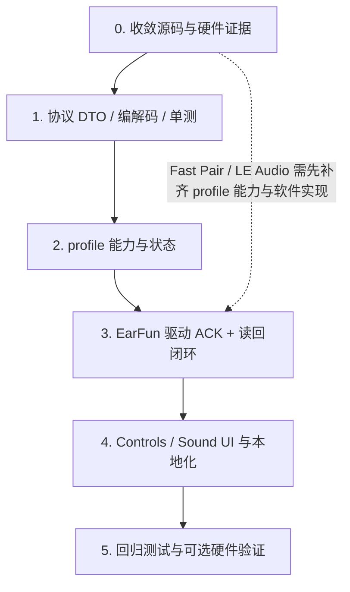

# EarFun 查找、提示音与音频模式功能开发计划

本文基于 WaveTune 代码、[EarFun GAIA V3 API 记录](../api/EARFUN_BLUETOOTH_API.md)及 [Gadgetbridge 项目](https://codeberg.org/Freeyourgadget/Gadgetbridge) 的 EarFun 实现制定，并记录本轮实施结果与剩余验收项。真机验证状态只描述证据，不是已注册型号开放 profile 声明功能的前置条件；功能开放由 compatibility profile 能力及 WaveTune 的实现范围决定。

## 当前实施状态

- 已完成协议 DTO/编解码、严格查询响应解析、按 profile 初始化查询、型号能力门控，以及 Controls 页面查找/提示音/麦克风控件和中英文文案。降噪和查找设备均保留原有 GAIA 写入流程：发送命令并短暂排空事件，不强制要求 SET ACK 或立即 GET 回读；提示音和麦克风模式继续使用其已实现的响应/读回流程。
- 查找控件使用卡片内的浮动菜单选择左耳、右耳或双耳，并用单个查找/停止按钮控制；持续显示大音量警告，不再要求用户通过确认对话框继续。OPPO 等不支持单耳选择的型号隐藏目标菜单，保留双耳查找/停止。
- 当前 profile 开放范围：Air Pro 4 支持查找、提示音音量和麦克风模式；Free Pro 3 仅支持查找；Air S 不开放这三项。提示音 UI 为 `0..=4`（关闭至最大），并通过反向映射转换 wire 值。
- 自动化协议、兼容性与模拟会话测试已通过；这些测试不证明设备 ACK、固件行为或实际效果。尚未进行任何真机写入验证，但这不阻止 profile 已声明并由 WaveTune 实现的功能开放。
- Fast Pair / LE Audio 目前只有协议值编解码及单测；没有型号能力声明、初始化查询、驱动命令或 UI。因此目前不开放的原因是 capability 与功能实现尚缺，而非未完成硬件验证。
- 硬件验证可作为后续补充证据并更新 API 记录，不是本计划的软件验收前置条件；不得将未验证表述成已完成硬件验证。

## 1. 目标与范围

评估并规划以下 EarFun 控制项：

1. 查找耳机（Find Device）。
2. 提示音音量（Voice Prompt Volume）。
3. 麦克风模式：自动、左耳、右耳。
4. Google Fast Pair / LE Audio 高级音频模式切换。

遵循 compatibility profile 和协议能力门控。未知型号保持只读；已注册型号按 profile 声明开放 WaveTune 已实现的功能，无需真机验证作为额外条件。支持明确 ACK/读回语义的设置按对应流程确认；EarFun 降噪沿用兼容既有 GAIA 固件的写入时序，不额外假设 ACK 或立即读回行为。客户端源码说明不等同于设备硬件验证；不得把源码证据说成实测，也不得猜测响应、固件行为或重启要求。

## 2. 实施前代码评估（基线）

### 已有、可复用的基础

- [`src/protocol/brands/earfun/earfun_commands.rs`](../../src/protocol/brands/earfun/earfun_commands.rs) 已定义所有目标指令常量：查找 `0x0332/0x0333`、提示音 `0x0338/0x0339`、麦克风 `0x0330/0x0331`、高级音频模式 `0x034B/0x034C`。`0x034D` 音频模式状态也已有解析器，但它不是 Fast Pair / LE Audio 设置值的读回解析器。
- [`src/bluetooth/brands/earfun/transport.rs`](../../src/bluetooth/brands/earfun/transport.rs) 已提供请求超时、GAIA 响应命令匹配与状态码检查的 `request()`，可作为写操作 ACK 及查询读回的基础。现有 `send_command()` 只确认字节已写入；`drain_stream()` 不能代替 ACK。
- 实施前通用应用层已有 `WorkerCommand::FindEarbuds(bool)`、`SetPromptVolume(u8)`、`UiUpdate::IsFindingEarbuds`、`PromptVolume` 和相关支持位；控制页原有单一查找切换按钮和提示音滑块。
- 实施前 [`src/compatibility/brands/earfun/earfun_catalog.rs`](../../src/compatibility/brands/earfun/earfun_catalog.rs) 已给 Air Pro 4 和 Free Pro 3 声明 `FIND_DEVICE`、`PROMPT_VOLUME`，但驱动快照尚未据此开放控件。
- EarFun 目前已接入手势、触控锁、入耳检测、降噪、游戏模式、EQ、编解码器及多设备等会话逻辑；本计划应复用现有驱动、快照和 Controls/Sound 切片，而非另建传输或会话框架。

### 当时尚未打通的代码路径

- [`src/bluetooth/brands/earfun/init.rs`](../../src/bluetooth/brands/earfun/init.rs) 读取触控等状态，但不查询查找状态、提示音音量、麦克风模式或 `0x034C` 高级音频模式；构造 `ControlsSnapshot` 时也没有填入查找/提示音支持位和音量。
- [`src/bluetooth/brands/earfun/features/controls.rs`](../../src/bluetooth/brands/earfun/features/controls.rs) 目前处理入耳检测、触控手势及触控锁，没有上述新功能的查询/设置方法。
- [`src/bluetooth/brands/earfun/driver.rs`](../../src/bluetooth/brands/earfun/driver.rs) 尚未为查找、提示音、麦克风或高级模式命令建立处理闭环；即使通用 UI 能发相应 `WorkerCommand`，也不能据此认定 EarFun 已支持。
- [`src/protocol/brands/earfun/earfun_parsers.rs`](../../src/protocol/brands/earfun/earfun_parsers.rs) 尚无目标设置的强类型解析器；高级模式枚举/解析也未实现。当前 `SoundSnapshot` 仅覆盖现有音频功能和 codec，不含高级音频模式状态。
- 通用提示音滑块目前固定为 `1..=10`。EarFun 源码记录的 wire 值为 `0..=4` 且方向反转，不能直接把当前滑块整数发给 EarFun。实施前查找 UI 是开始/停止按钮，而协议设置值包含左右耳选项；本轮据用户反馈将其改为卡片内直接选择，不再采用原先仅双耳查找的初步建议。

## 3. 源码证据与初步设备范围

| 功能 | Gadgetbridge 源码记录 | WaveTune 首期目标与门槛 |
|---|---|---|
| 查找耳机 | Air Pro 4 与 Free Pro 3 设置界面/查询路径包含此功能。设置 `0x0332`，查询 `0x0333`；值 `0` 停止、`1` 左耳、`2` 右耳、`3` 双耳。未找到 Air S 对应界面/查询证据。此为客户端源码证据，API 文档未记录硬件成功轨迹。 | Air Pro 4、Free Pro 3。卡片内浮动菜单选择左耳、右耳或双耳，单个按钮启动并变为停止；警告文案常驻显示。 |
| 提示音音量 | Air Pro 4 界面提供此设置，`0x0338 [volume]` 设置、`0x0339` 查询；线值 `0` 最大、`4` 关闭。Free Pro 3 共用的设置请求会查询该项，但其设置界面未提供控制。未找到 Air S 设置证据。未有固件限定的硬件轨迹。 | 按已注册 profile 的能力声明开放；当前 WaveTune profile 仅对声明支持的型号开放。是否有硬件轨迹单独记录，不作为开放门槛。 |
| 麦克风模式 | Air Pro 4 声音设置提供模式选择；`0x0330 [mode]` 设置、`0x0331` 查询，`0` 自动、`1` 左耳、`2` 右耳。Free Pro 3 的共享设置查询路径包含查询，但界面没有相应控制；未找到 Air S 支持证据。未有硬件成功轨迹或明确固件范围。 | 按已注册 profile 的能力声明开放；目前仅支持相应能力的型号显示控制。硬件验证状态单独记录，不作为额外门槛。 |
| Fast Pair / LE Audio 模式 | Gadgetbridge 的 Air Pro 4 设置界面提供 `0x034B` 设置、`0x034C` 查询选项：`0` Fast Pair、`1` LE Audio。源码编码一字节值，通用设置界面有重启确认提示，但未证明需要实际发送重启；无具体固件硬件行为、成功读回或音频链路验证。 | 当前 WaveTune 尚未为该功能建立 profile 能力、初始化查询、驱动命令或 UI，因此不开放；这不是等待真机验证的门槛。不假设设置后应发送 `0x0308` 重启。 |

机型结论表示 Gadgetbridge 代码中的客户端功能范围，不表示 WaveTune 已验证、设备已实现该功能或所有固件兼容。硬件验证如有执行，应记录准确型号/固件和各模式的设置、读回、重连及实际效果，不记录个人设备标识；验证状态不改变 WaveTune compatibility profile 的功能门控。

## 4. 实施阶段

### 阶段 0：收敛证据及安全合同

- 复核 API 文档与 Gadgetbridge 发送/接收路径，确认每个 setter 的 ACK 命令与状态格式、query 返回格式、枚举范围及失败响应；客户端设置界面和通用 `[status, value]` 格式不能单独证明具体型号的设备行为。
- 确认现有 `request()` 对 setter 命令的 ACK 匹配适用性。对 WaveTune 已实现的写入，不得把 `write_all` 成功或短暂排空流视为成功；保留原状态并呈现错误，直到软件实现具备明确的确认语义。此软件安全要求不依赖先完成真机验证。
- 真机验证可自愿补充 Air Pro 4、Free Pro 3 的查询、设置和实际效果证据，但不作为已注册 capability 开放功能的要求。每次如进行验证，只执行一个设置，不与其他控制连接并行操作同一耳机。
- 输出确认的型号/固件能力范围。若某功能没有 WaveTune capability 声明或对应实现，保持未开放；若已声明且已实现，则按 profile 开放，并保留 ACK/读回的软件状态保护。

### 阶段 1：协议 DTO、编解码与单测（代码已完成）

- 在 `src/protocol/brands/earfun/` 新增适当的控制/高级模式协议模块，或扩展现有 parser/controls 模块（遵守领域拆分与模块大小规范）；在 `mod.rs` 导出类型与纯函数。
- 添加强类型 `EarFunMicrophoneMode`（Auto/Left/Right）、`EarFunFindMode`（Off/Left/Right/Both）和 `EarFunAdvancedAudioMode`（Fast Pair/LE Audio），拒绝未定义值。
- 为目标 GET 响应实现严格校验：长度满足字段要求、状态码为成功、值属于支持枚举；为 SET 构造单字节 payload。不要将响应解析失败转成默认模式或音量。
- 提示音协议值与 UI 逻辑值通过明确的映射函数转换：建议 UI 采用语义递增的 `0..=4`（关闭至最大），wire 值为 `4 - ui_value`；映射边界、单调性及往返转换须有测试。OPPO 现有 `1..=10` 行为不变。
- 覆盖合法/非法 status、截断 payload、越界值、全部枚举、查找 start/stop 的线值及音量反转边界。编解码测试使用匿名数据，不包含真实设备标识。

**完成标准：** 所有纯协议逻辑有字节级测试；异常 payload 只能返回明确错误，不产生看似成功的值。

### 阶段 2：型号能力与状态模型（代码已完成）

- 在兼容层按客户端源码证据声明型号能力，仅为 profile 标记支持的型号开放对应功能；不要求真机验证作为额外门槛。未声明的型号/功能仍保持关闭。
- 新增麦克风模式与高级音频模式的 profile 能力时，不以“命令常量已存在”作为支持条件；能力声明、身份解析和对应驱动/UI实现齐备后按 profile 开放。
- 扩充 `ControlsSnapshot`、`ControlsState`：麦克风模式支持位/当前值、查找支持位/运行状态、提示音显示范围/当前逻辑值。扩充 `SoundSnapshot` / `SoundState`：高级模式支持位/当前值。
- 在状态归约和断开重置路径中同步新增字段；初始化查询失败时状态应为未知，不能用默认值填充。

**完成标准：** profile、快照与 UI 派生能力一致；未知设备及 profile 未声明的功能不显示、不接受写入，断开后无旧设备状态残留。已声明并实现的功能不因缺少真机验证而关闭。

### 阶段 3：EarFun 会话读写闭环（基础控制代码已完成）

- 在 `src/bluetooth/brands/earfun/init.rs` 中，仅对 profile 支持的功能逐项查询；把响应解析结果写入快照和 diagnostics。查找初始状态应准确反映耳机当前 mode；不可读时保持未知。
- 在 EarFun controls feature 内实现查找、提示音、麦克风查询/设置；在 sound feature 或单独的高级模式 feature 中实现 `0x034C/0x034B`。提示音和麦克风模式按各自支持的 `request()` 响应关联语义处理；降噪和查找设备写入不属于 ACK/GET 闭环。
- 扩展 `EarFunDriver::handle_command`：按当前 profile 做第二道写入门控。提示音、麦克风等支持明确确认语义的设置按对应 ACK/读回流程实现；降噪和查找设备继续使用各自原有命令与事件排空流程，不要求额外 ACK/立即读回。
- 查找卡片按用户选择发送 `SET_FIND_DEVICE(1/2/3)`，停止发送 `SET_FIND_DEVICE(0)`；命令成功写入后按请求模式更新 UI，不能等待不保证存在的 ACK 或 GET 回读。该 UI 状态表示已发送的目标，不保证设备实际鸣响；写入失败时保留原模式并显示错误。
- 当前高级模式未加入会话初始化与命令分支，原因是尚无 profile 能力、驱动和 UI 实现，而不是硬件验证未完成。未来如加入，按型号能力与协议实现接入；不推断重启或重连流程。

**完成标准：** 对支持该协议语义的设置，mock RFCOMM 测试覆盖 SET -> ACK/GET 确认及失败行为；降噪测试覆盖原有 master/sub-mode 命令顺序和排空流程，查找测试覆盖左/右/双耳及停止命令不依赖 ACK/GET。不得因其他设置的 ACK/读回设计改变 EarFun 降噪或查找的兼容写入行为。

### 阶段 4：Controls / Sound UI 与本地化（基础控制代码已完成）

- 复用 Controls 页查找卡片和提示音滑块；根据能力在浮动菜单中显示可选查找目标，并以同一个按钮开始/停止查找，按钮状态只由后台确认结果驱动。查找警告常驻在卡片内，不弹出阻断操作的确认对话框。音量交互继续防抖，但成功/失败状态由后台确认结果驱动，失败时恢复最近一次确认值。
- 在 Controls 页新增麦克风模式选择项（自动、左耳、右耳），绑定强类型状态与命令；只在支持的设备显示。异步设置时禁用控件，收到成功读回后才更新显示。
- 仅在高级模式具备明确的型号能力声明及 WaveTune 协议/状态/UI实现后，才在 Sound/设备音频设置区加入 Google Fast Pair / LE Audio 选项；真机验证不是额外门槛。不得照搬 Gadgetbridge 的通用重启确认而推断需要主动重启。
- 补充中英文 Fluent 标签、描述、状态和错误文案；描述中不要将源码推断写成已验证硬件能力。控件生命周期、设备切换、未知状态和断连重置符合现有 MVI 模式。

**完成标准：** Air Pro 4 / Free Pro 3 仅显示各自经过能力配置的功能；提示音滑块的视觉与 wire 值方向正确；未确认设置不能让界面出现乐观成功状态。

### 阶段 5：自动化验证与硬件验收（自动化完成，硬件验收待完成）

- 协议单测：状态码、payload 长度、值范围、枚举转换、音量映射、查找模式。
- 会话 mock 测试：初始化查询顺序、适用设置的 setter ACK 和读回一致/不一致、ACK 拒绝、查询超时、异常断连、快速连续滑动防抖、停止查找，以及切换耳机时清除新状态；降噪单独验证原有 SET 顺序、短延迟和排空行为。
- 能力回归测试：控件显示严格跟随预定义 profile 能力；型号不支持或 WaveTune 尚未实现的功能保持关闭。真机验证状态不改变显示/写入能力。
- 控件测试：滑块端点 0/4 映射、回读同步、设置失败恢复旧值、未知状态不显示虚假值、断连重置、无障碍与中英文文案。
- [ ] （可选）真机逐功能验证并更新 API 文档与兼容性证据：记录型号、固件、操作值、ACK、回读值、实际效果和重连行为；不导出或记录地址、序列号、配对主机名称。

**最终完成标准：** `cargo fmt --check`、相关 `cargo test --locked` 及 `cargo check --locked` 通过，profile 能力和对应实现通过软件测试。逐机型真机记录为可选补充，不是功能开放或本计划完成条件。

## 5. 建议工作依赖

查找、提示音和麦克风共用状态/驱动/UI基础设施，可在阶段 1–4 中合并开发。高级模式不是基础控制的前置条件；若缺少对应 capability、身份解析或软件实现，则保持未开放并记录缺项，不应仅为“功能齐全”强行加入未经实现的写入功能。

## 6. 主要风险与决策

| 风险 | 处理 |
|---|---|
| Gadgetbridge 有 UI/命令定义但无真机验证轨迹 | 源码支持与硬件验证事实分列；仅对 WaveTune compatibility profile 已声明且已实现的功能开放，真机验证不是额外门槛。 |
| 当前 `send_command()` 后排空数据被误认为 ACK | 新写入走可验证响应关联的请求路径；必须在 GET 读回一致后更新状态。 |
| 音量 wire 值方向与现有 OPPO UI 不同 | 由 profile 提供型号范围/映射；转换纯函数独立测试，禁止改坏 OPPO 1–10 滑块。 |
| profile 声明范围宽于客户端设置界面证据 | 首期收窄提示音到 Air Pro 4；Free Pro 3 等待证据后独立启用。 |
| 查找耳机播放高音量提示 | 在卡片内持续显示取下耳机的警告，并提供即时停止动作；仅对源码确认支持单耳模式的型号显示左右耳选项。 |
| Fast Pair / LE Audio 切换可能影响连接或要求重启 | 在补齐 profile 能力和软件实现前不开放；不猜测重启、不默认发送 `0x0308`。 |
| 查询失败被当成 off/自动/默认音量 | 状态保持 `None`/未知，向用户呈现真实错误或未读状态；不回填成功形状的默认值。 |
