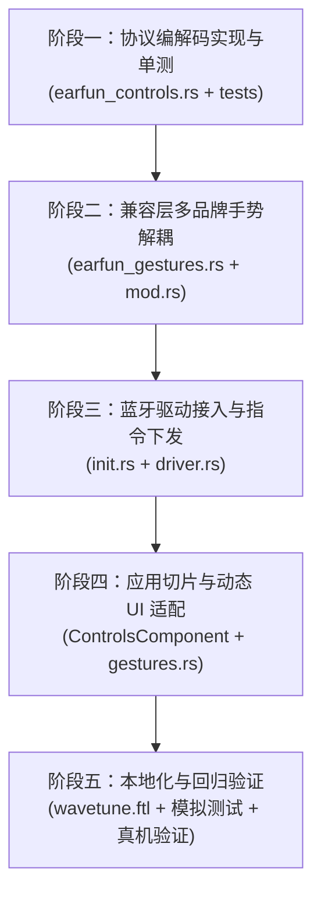

# EarFun 耳机手势控制功能开发计划

本文档为 WaveTune 接入 **EarFun 品牌无线耳机（EarFun Air Pro 4、EarFun Free Pro 3、EarFun Air S）手势控制与触控锁定功能**的完整开发计划。

设计参考了 Android 开源客户端 [Gadgetbridge](file:///home/onlymash/Projects/WaveTune/external/Gadgetbridge)（PR #4635）的底层实现及真实硬件通信规范，并严格遵循 WaveTune 的 [轻量 MVI 架构与分层设计规范](file:///home/onlymash/Projects/WaveTune/docs/guide/ARCHITECTURE_GUIDELINES.md) 与 [代码规范](file:///home/onlymash/Projects/WaveTune/AGENTS.md)。

---

## 一、 背景与目标

### 1.1 背景
当前 WaveTune 的手势控制界面与底层实现主要针对欧加体系（OPPO/OnePlus/realme）设计，`src/compatibility/mod.rs` 与 `src/ui/pages/controls/gestures.rs` 静态绑定了 OPPO 的 7 个手势行模板（`STANDARD_GESTURE_ROWS`）及特定动作枚举。

虽然 EarFun 驱动与机型目录已在 `src/compatibility/brands/earfun/earfun_catalog.rs` 中声明了 `features::TOUCH_CUSTOMIZATION`，但尚未打通：
1. EarFun GAIA V3 私有触控查询与配置协议编解码；
2. 多品牌手势数据结构解耦与动态分发；
3. EarFun 专属的 4 项交互手势（单击、双击、三击、长按）与 13 项动作功能映射；
4. 触控锁定模式（Touch Lock Mode）控制。

### 1.2 目标
- **协议层**：实现纯净、无状态的 EarFun 触控手势查询（`0x030B`）、配置（`0x030A`）及触控锁定（`0x0334`/`0x0335`）编解码，覆盖率 100% 的单元测试；
- **兼容层**：解耦顶层通用手势定义，建立 `src/compatibility/brands/earfun/earfun_gestures.rs`，按型号（Air Pro 4、Free Pro 3、Air S）区分动作集；
- **驱动层**：在 `EarFunDriver` 初始化时完整拉取手势配置与触控锁状态，在用户调整时安全下发单指令并处理 ACK 回读；
- **UI 层**：改造手势卡片支持依据机型 `gesture_rows` 动态构建控件，隐藏不适用的呼叫控制与降噪掩码复选框，新增触控锁定开关；
- **本地化**：补充中英文 Fluent 国际化词条（电话重拨、各类降噪轮换对、触控锁定）。

---

## 二、 协议规范与机型能力对比 (基于 Gadgetbridge 源码分析)

经审计 `external/Gadgetbridge` 中 `EarFunProtocol.java`、`EarFunPacketEncoder.java`、`EarFunResponseHandler.java` 及各机型 XML 设置，EarFun 触控手势机制总结如下：

### 2.1 指令与数据载荷规范

#### 1. 触控手势查询（Touch Gestures Query）
- **查询指令**：`0x030B`，空载荷 `[]`
- **响应指令**：`0x830B`
- **响应载荷结构（17 字节）**：
  - Byte `0`：状态码（`0x00` 或 `0x01`）
  - 后续依次为 8 个大端序 16 位整数（`Short`，低字节为有效动作代码，高字节为填充/保留）：
    - `Offset 1..2`：左耳 - 单击动作（Single Tap Left）
    - `Offset 3..4`：右耳 - 单击动作（Single Tap Right）
    - `Offset 5..6`：左耳 - 双击动作（Double Tap Left）
    - `Offset 7..8`：右耳 - 双击动作（Double Tap Right）
    - `Offset 9..10`：左耳 - 三击动作（Triple Tap Left）
    - `Offset 11..12`：右耳 - 三击动作（Triple Tap Right）
    - `Offset 13..14`：左耳 - 长按动作（Long Press Left）
    - `Offset 15..16`：右耳 - 长按动作（Long Press Right）

#### 2. 触控手势设置（Touch Gestures Setting）
- **设置指令**：`0x030A`
- **载荷格式（4 字节）**：
  - 左耳设置：`[interaction_type, action, 0x00, 0x00]`
  - 右耳设置：`[0x00, 0x00, interaction_type, action]`
- **交互类型代码（`interaction_type`）**：
  - 单击（Single Tap）：`0x01`
  - 双击（Double Tap）：`0x02`
  - 三击（Triple Tap）：`0x03`
  - 长按（Long Press）：`0x11` **（重要：Gadgetbridge 源码实证长按值为 0x11 即十进制 17，非 0x04）**
- **响应/应答**：`0x830A` ACK 状态帧

#### 3. 触控锁定模式（Touch Lock Mode）
- **查询指令**：`0x0335` $\to$ 响应 `0x8335 [00, mode]`（`0` = 触控开启，`1` = 触控锁定/禁用）
- **设置指令**：`0x0334 [mode]`（`0` = 开启，`1` = 锁定/禁用）

---

### 2.2 动作功能代码（Action Codes）与机型能力差异

| 动作代码 | 含义 (语义) | 对应 UI 标签 Key | Air Pro 4 (`0x004535`) | Free Pro 3 (`0x004534`) | Air S (`0x004c45`) |
|:---:|---|---|:---:|:---:|:---:|
| `16` (`0x10`) | 无动作 (None) | `controls-function-none` | ✅ | ✅ | ✅ |
| `1` | 播放 / 暂停 (Play/Pause) | `controls-function-play-pause` | ✅ | ✅ | ✅ |
| `2` | 音量增大 (Volume Up) | `controls-function-volume-up` | ✅ | ✅ | ✅ |
| `3` | 音量减小 (Volume Down) | `controls-function-volume-down` | ✅ | ✅ | ✅ |
| `4` | 上一首 (Previous Track) | `controls-function-previous` | ✅ | ✅ | ✅ |
| `5` | 下一首 (Next Track) | `controls-function-next` | ✅ | ✅ | ✅ |
| `6` | 语音助手 (Voice Assistant) | `controls-function-voice-assistant` | ✅ | ✅ | ✅ |
| `7` | 游戏模式切换 (Game Mode) | `controls-function-game-mode` | ✅ | ✅ | ✅ |
| `8` | 降噪模式全轮换 (All Modes) | `controls-function-noise-control-all` | ✅ (ANC/Normal/Ambient) | ✅ (ANC/Normal/Ambient) | ✅ (主环境音切换) |
| `9` | 降噪轮换 (正常 / 抗风噪) | `controls-function-noise-normal-wind` | ✅ | ✅ | ❌ |
| `10` | 降噪轮换 (正常 / 环境音) | `controls-function-noise-normal-ambient`| ✅ | ✅ | ❌ |
| `11` | 降噪轮换 (抗风噪 / 环境音) | `controls-function-noise-wind-ambient` | ✅ | ✅ | ❌ |
| `13` | 电话重拨 (Redial) | `controls-function-redial` | ✅ | ✅ | ❌ |
| **触控锁定** | 禁用全部触控防误触 | `controls-touch-lock` | ✅ (`0x0334/0x0335`) | ✅ (`0x0334/0x0335`) | ❌ (硬件不支持) |

---

## 三、 架构设计与技术改造方案

### 3.1 协议层（`src/protocol/brands/earfun/`）
保持纯函数无状态设计，严禁依赖 `compatibility` 或 `ui`。

1. **新建协议文件**：`src/protocol/brands/earfun/earfun_controls.rs`
   - 定义 `EarFunInteractionType`：
     ```rust
     #[derive(Debug, Clone, Copy, PartialEq, Eq)]
     #[repr(u8)]
     pub enum EarFunInteractionType {
         Single = 0x01,
         Double = 0x02,
         Triple = 0x03,
         Long = 0x11,
     }
     ```
   - 编解码函数：
     - `parse_earfun_touch_gestures_response(payload: &[u8]) -> Result<Vec<KeyFunction>, EarFunProtocolError>`
       - 解析 17 字节负载，提取 8 组 `KeyFunction`（左/右各 4 种手势）；
     - `encode_earfun_set_touch_gesture(side: EarSide, interaction: EarFunInteractionType, action: u8) -> Vec<u8>`
       - 编码 4 字节的 `0x030A` 载荷；
     - `parse_earfun_touch_mode_response(payload: &[u8]) -> Result<bool, EarFunProtocolError>`
       - 解析 `0x8335` 返回的布尔值（是否处于触控锁定状态）；
     - `encode_earfun_set_touch_mode(locked: bool) -> Vec<u8>`
       - 编码 `0x0334` 载荷（`0` 或 `1`）。
2. **单元测试集**：`src/protocol/brands/earfun/tests.rs`
   - 移植 Gadgetbridge 中的 18 字节真实测试向量（验证 8 个槽位精确切分）；
   - 验证左耳与右耳 `0x030A` 载荷的 4 字节偏移布局；
   - 验证触控锁定布尔值反转逻辑。

---

### 3.2 兼容层（`src/compatibility/`）
彻底解耦手势配置表的品牌硬编码，实现多品牌动态分发。

1. **新建 EarFun 手势配置**：`src/compatibility/brands/earfun/earfun_gestures.rs`
   - 定义 EarFun 手势行集合：
     - `EARFUN_AIR_PRO_4_GESTURE_ROWS`: 单击、双击、三击、长按，允许函数 `&[16, 1, 2, 3, 4, 5, 6, 7, 8, 9, 10, 11, 13]`，`edits_noise_cycle: false`, `is_call_control: false`；
     - `EARFUN_FREE_PRO_3_GESTURE_ROWS`: 与 Air Pro 4 相同；
     - `EARFUN_AIR_S_GESTURE_ROWS`: 单击、双击、三击、长按，允许函数 `&[16, 1, 2, 3, 4, 5, 6, 7, 8]`；
   - 提供动作文本映射函数：`earfun_gesture_function_label_key(function: u8) -> &'static str`。
2. **重构顶层手势分发**：`src/compatibility/mod.rs`
   - 修改 `gesture_rows_for_product(product_id: u32) -> &'static [GestureRow]`：
     - 根据产品 ID 判断品牌（或通过已知 profile 派生），若为 EarFun 型号，派发至 `earfun_gestures.rs` 对应表；否则派发至 OPPO 表；
   - 统一动作标签解析：`gesture_function_label_key(product_id: u32, function: u8) -> &'static str` 或在 `GestureRow` 中提供局部映射，确保 EarFun 的动作代码与 OPPO 的代码共存互不干扰；
   - 在 `features` 常量中引入 `features::TOUCH_LOCK = "touch-lock"`（仅 Air Pro 4 和 Free Pro 3 声明）。

---

### 3.3 蓝牙与驱动层（`src/bluetooth/brands/earfun/`）
在后台 IO 线程中安全调度 GAIA 触控指令。

1. **会话初始化（`init.rs`）**：
   - 若 `profile.supports_touch_customization()`：
     - 发送 `0x030B` 查询当前手势，解析并填入 `snapshot.controls.key_functions`；
     - 获取型号专属的 `gesture_rows` 并填入 `snapshot.controls.gesture_rows`；
     - 标记 `snapshot.controls.supports_touch_customization = true`；
   - 若 `profile.has_feature(features::TOUCH_LOCK)`：
     - 发送 `0x0335` 查询当前触控锁定状态，更新 `snapshot.controls.touch_lock_enabled`。
2. **命令执行（`features/controls.rs` 与 `driver.rs`）**：
   - 处理 `WorkerCommand::SetGesture { side, button: _, action, function }`：
     - 将通用 `GestureAction` 转换为 `EarFunInteractionType`（`SingleSqueeze` $\to$ `Single`, `DoubleSqueeze` $\to$ `Double`, `TripleSqueeze` $\to$ `Triple`, `SqueezeAndHold`/`LongHold` $\to$ `Long`）；
     - 发送 `SET_TOUCH_ACTION`（`0x030A`）；
     - 等待 ACK，并在成功后回读 `0x030B` 校验或推送 `UiUpdate::KeyFunctions`；
   - 新增 `WorkerCommand::SetTouchLock(bool)`：
     - 发送 `SET_TOUCH_MODE`（`0x0334`），校验 ACK 后推送 `UiUpdate::TouchLockEnabled(bool)`。

---

### 3.4 状态与切片控制器（`src/app/features/controls/` & `src/app/state.rs`）
遵循单向数据流 MVI。

1. **状态扩充（`ControlsState` / `ControlsSnapshot`）**：
   - 增加 `touch_lock_enabled: Option<bool>` 与 `supports_touch_lock: bool`；
2. **事件流扩充（`src/app/events.rs`）**：
   - `WorkerCommand::SetTouchLock(bool)`；
   - `UiUpdate::TouchLockEnabled(bool)`；
3. **控制器绑定（`ControlsController`）**：
   - 响应触控手势下拉项变更，派发 `WorkerCommand::SetGesture`；
   - 响应触控锁定开关变更，派发 `WorkerCommand::SetTouchLock`；
   - 当 `touch_lock_enabled` 为 `true` 时，置灰手势配置选择框（视觉反馈已锁定）。

---

### 3.5 UI 组件重构（`src/ui/pages/controls/`）
解决当前手势控件静态化问题，满足多品牌形态差异。

1. **手势列表动态渲染改造（`gestures.rs`）**：
   - 目前 `build_gesture_groups()` 在启动时仅针对 OPPO 静态构建 `gesture_combos`；
   - 改造方案：
     - 方案 A（动态重建）：当设备连接且 `gesture_rows` 下发时，清空容器并根据实际 `GestureRow` 动态生成 `adw::ComboRow` 并绑定事件；
     - 方案 B（最大集预分配 + 动态重置 items/visible）：预留手势槽位，根据 `state.controls.gesture_rows` 动态更新 `ComboRow` 的标签、可选下拉项（`set_items`）及显隐状态；
   - 经评估采用 **方案 B**，能最大化复用现有 `GestureSettingsWidgets` 并防止 GTK 控件频繁销毁重建导致闪烁与内存泄露；
2. **专有控件适配**：
   - **呼叫手势组（`call_gesture_group`）**：若当前 `gesture_rows` 中无呼叫控制（EarFun 全型号均无），整组保持 `set_visible(false)`；
   - **降噪循环复选框（`cycle_section`）**：EarFun 的降噪为单一行为选项（`0x08`），无需 OPPO 的左右耳掩码复选框，保持隐藏；
   - **新增触控锁定开关（`touch_lock_switch`）**：作为 `adw::SwitchRow` 挂载在手势组首行或硬件控制组中，受 `supports_touch_lock` 门控。

---

## 四、 实施步骤与任务分解 (Phased Roadmap)



### 阶段一：协议编解码实现与单测
- [ ] 编写 `src/protocol/brands/earfun/earfun_controls.rs`，包含 `EarFunInteractionType`、手势查询/设置、触控锁定编解码纯函数；
- [ ] 导出模块至 `src/protocol/brands/earfun/mod.rs`；
- [ ] 在 `src/protocol/brands/earfun/tests.rs` 补充完整单元测试，验证解析与编码的字节一致性。

### 阶段二：兼容层多品牌手势解耦
- [ ] 编写 `src/compatibility/brands/earfun/earfun_gestures.rs`，定义 Air Pro 4、Free Pro 3、Air S 的静态 `GestureRow` 数组；
- [ ] 重构 `src/compatibility/mod.rs`，将单品牌 `STANDARD_GESTURE_ROWS` 升级为多品牌分发的 `gesture_rows_for_product`；
- [ ] 在 `src/compatibility/brands/earfun/earfun_catalog.rs` 确认特征声明，为 Air Pro 4 和 Free Pro 3 补充 `features::TOUCH_LOCK`。

### 阶段三：蓝牙驱动接入与会话生命周期
- [ ] 修改 `src/bluetooth/brands/earfun/init.rs`，在握手阶段加入 `0x030B` 与 `0x0335` 状态查询并写入 `ControlsSnapshot`；
- [ ] 扩展 `src/bluetooth/brands/earfun/features/controls.rs`，实现 `set_touch_action` 与 `set_touch_mode`；
- [ ] 在 `src/bluetooth/brands/earfun/driver.rs` 的 `handle_command` 中接入 `SetGesture` 与 `SetTouchLock` 分发与状态回读。

### 阶段四：UI 表现层动态化与业务切片完善
- [ ] 扩充 `ControlsSnapshot`、`ControlsState` 及 `UiUpdate`，加入触控锁定状态支持；
- [ ] 重构 `src/ui/pages/controls/gestures.rs`，使 `ComboRow` 支持根据当前连接耳机的 `GestureRow` 动态刷新选项条目（`set_items`）；
- [ ] 在手势组增加“触控锁定（Touch Lock）”开关卡片；
- [ ] 验证呼叫手势组与降噪掩码复选框在 EarFun 接入时正确自动隐藏。

### 阶段五：国际化、自动化测试与真机联调
- [ ] 更新 `locales/zh-CN/wavetune.ftl` 与 `locales/en-US/wavetune.ftl`，补充触控锁定与 EarFun 动作文本；
- [ ] 编写跨品牌手势分发回归测试；
- [ ] 编写模拟 RFCOMM 数据流的会话测试，验证手势写入与 ACK 闭环；
- [ ] 在已连接的真实 EarFun Air Pro 4 上运行 `cargo run -- --probe` 与 GUI 联调测试，确认物理耳机手势即时生效。

---

## 五、 协议安全底线与测试规范

1. **单指令安全管道**：
   触控手势配置写入必须单条顺序下发（每次 1 条 `0x030A`），等待 `0x830A` ACK 后再处理下一项或发送 `0x030B` 校验，禁止并发下发；
2. **未知型号只读防线**：
   Product ID 未在 `EARFUN_DEVICE_PROFILES` 注册的设备保持严格只读，手势配置与触控锁控件强制敏感度置灰（`set_sensitive(false)`）；
3. **触控锁定互斥防护**：
   当用户开启触控锁定时，UI 上的左右耳单击/双击/三击/长按下拉菜单立即置灰禁用，防止用户在锁定状态下误以为手势配置失效；
4. **长按交互码准确性防线**：
   严格使用 `0x11` 作为 Long Press 的 interaction_type，禁止回退使用误导性的 `0x04`，避免固件静默丢弃或报错。

