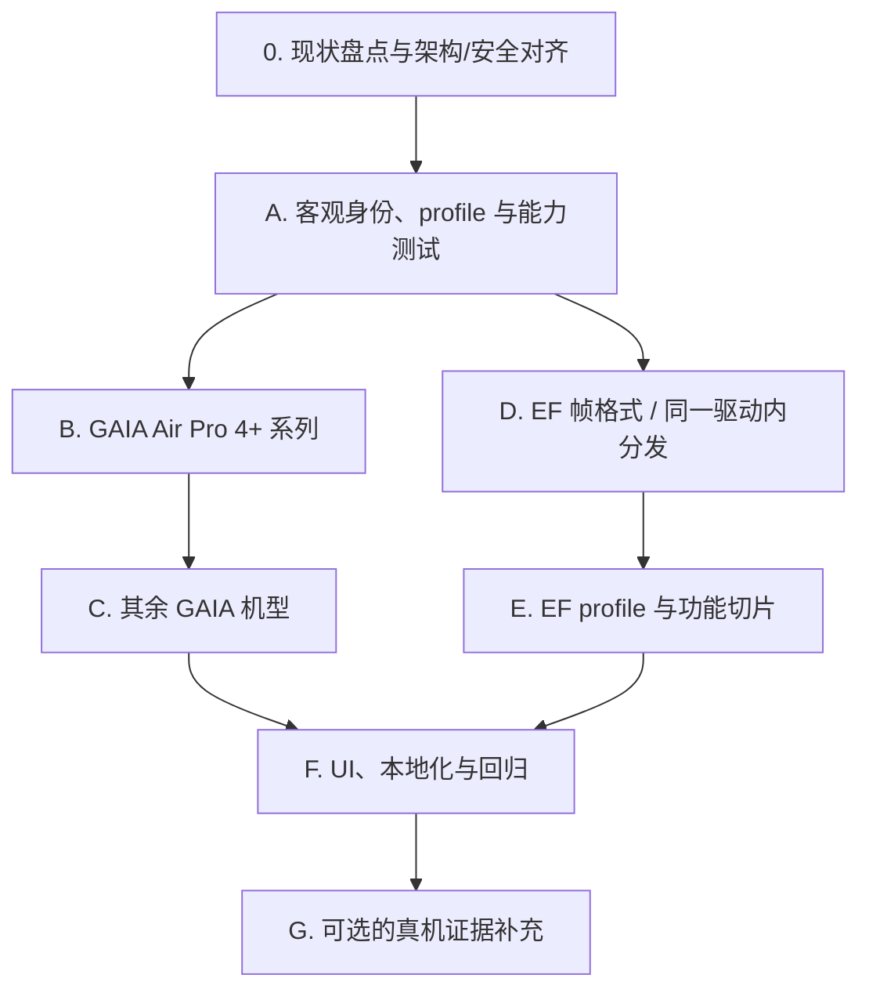

# EarFun 机型支持扩展开发计划

本计划基于 [EncoDeck 项目](https://github.com/TIANLI0/EncoDeck) 新增的 EarFun 机型与协议资料，扩展 WaveTune 现有 EarFun 支持。协议依据见[更新后的 EarFun API 记录](../api/EARFUN_BLUETOOTH_API.md)。EncoDeck 将其实现归因于 EarKit commit `a77acd18890a5f28746c2303bfff0e23fff8d8ca`；这些是客户端源码证据，硬件验证状态单独记录，不作为预定义机型开放对应功能的前置条件。

实施须沿用 WaveTune 当前的 `DeviceProfile` / `compatibility::registry`、`HeadsetDriver` / `AnyDriver` / `SessionRunner`、EarFun 垂直 feature 切片和 MVI 状态事件流。该工作不是新建第二套品牌驱动或重写会话执行器；只在需要处给现有兼容层和 EarFun 驱动增加机型身份及协议族差异。

## 一、目标与范围

WaveTune 目前支持三款 GAIA 机型：EarFun Air Pro 4（`TW600`）、Free Pro 3（`TW400`）和 Air S（`TWA01` / `TW201`）。EncoDeck 收录了横跨 GAIA 与独立 EF 帧格式的 23 个机型记录。计划按以下阶段扩展：

1. **首个里程碑：** Air Pro 4+（EncoDeck profile ID `TW700`）；Air Pro 4+AI（`TW700AI`）和 Air Pro 5（`TW800`）作为独立机型身份处理，即使 EncoDeck 将它们归入相同的 `tw700` 行为变体。
2. **其余 GAIA 机型：** Air Pro 3 变体、EarFun Free 2S、新版 Air S 身份、ATVEL Tune S5 ProX 和 Wave Pro X。
3. **EF 协议机型：** Air 2 NC 变体、Air Life、Air Pro 4i、OpenJump 变体、Clip / Clip 2、Wave Life、Tune Pro 和 Wave Pro 2。

目标清单为 API 文档中记录的 EncoDeck 23 个机型。不能仅因 EncoDeck 收录某机型就认定 WaveTune 已支持；型号须明确注册在 WaveTune compatibility 目录中，并具备客观身份解析、型号专属能力声明及对应软件测试。注册后按 profile 声明开放 WaveTune 已实现的功能，无需先完成逐型号真机验证。

### 不在范围内

- 固件升级、OTA、未公开协议扫描或向未知机型写入。
- 恢复出厂（GAIA `0x0336` / EF `0x1000`）：该操作会清除配对，具有破坏性。
- Google Fast Pair / LE Audio 切换；EncoDeck 控制的是传统蓝牙 SPP 链路，不负责建立这些音频模式。
- 未注册在 WaveTune compatibility 目录中的型号，不因 EncoDeck 收录或合成测试数据而开放功能；蓝牙显示名称不得作为身份依据。
- 真机验证状态用于区分证据与记录，不是已注册型号开放其 profile 声明功能的额外门槛。

## 二、身份识别与证据门槛

这是首要开发门槛：WaveTune 当前用制造商数据中的数字 `product_id` 解析 `DeviceProfile`，缺少该值时，GAIA 初始化再尝试从 `0x0309` 固件响应识别现有机型。EncoDeck 则按设备名称选择 profile 后查询固件。WaveTune 必须继续遵循“蓝牙名称和用户别名只用于显示”的约束，不能照搬 EncoDeck 的名称匹配。

- 保持通用 `DeviceProfile`、`profile_for_product_id()` 与现有 `0x004535`、`0x004534`、`0x004C45` 查找兼容；不要给新机型编造数字 PID，也不要把 EncoDeck profile ID 当作固件项目代号。
- 若新机型无数字 PID，先确认其协议族和固件身份查询路径，再设计 EarFun 专属身份解析（例如强类型 `EarFunModelId` 与独立解析函数），并将解析结果明确传入现有 EarFun 驱动/profile 流程。只有必要时才以向后兼容的方式扩展通用兼容层，禁止在协议模块依赖 `compatibility`。
- 映射新机型前，核实其精确固件标识。`TW700`、`TW700AI` 和 `TW800` 当前只是 EncoDeck profile ID；源码未证明它们是固件返回的项目代号，也没有确认相应数字制造商产品 ID。
- 在采用“先查询固件再确定机型”前，确认不同协议族的固件查询命令如何被安全选择：WaveTune 当前 GAIA 路径查询 `0x0309`，EncoDeck 对 EF 机型用 `0x1010`。若无法在不依赖名称的情况下确定首个查询/协议族，则该机型暂不可接入。
- 查明 `TW220` / `TW220_VDL`、`OW100` / `OW100_NEW` 等变体是否具有不同固件标识或其他客观区分方式。若没有，则不要按设备名称猜测变体，保持只读。
- 为缺失、格式错误、未知和有歧义的身份信息增加测试，确保安全落入现有只读路径。profile 确认之前，不发送型号专属查询。
- 在 API 文档中分别记录各机型来源、可信度和真机验证状态；验证状态仅作证据记录，不用作功能门控。

**门槛：** 新增 profile 前，必须能在不依赖显示名称的情况下确定机型身份及协议族，并实现其对应协议路径。满足后按预定义 capability 开放已实现功能；是否做过真机验证不影响该开放决定。身份或协议族无法客观确定、或命令尚未实现的机型仍不得加入可写运行时 profile。

## 三、实施阶段

### 阶段 0：WaveTune 现状盘点与架构/安全对齐

在修改机型目录或发出新协议命令前，先以当前代码和测试为基线，形成逐项差异表；不因新增品牌型号另建架构：

- **发现与身份流：** 梳理 `src/bluetooth/discovery.rs`、`DeviceChoice`、`src/bluetooth/brands/earfun/init.rs` 和 `compatibility::registry`。确认 EarFun 的品牌发现、制造商数据 PID、`discovered_product_id.or_else(firmware_pid)` 优先级、未知机型查询范围，以及从 GAIA/EF 首次识别协议族的可行方式。
- **现有扩展点：** 对照 `DeviceProfile`、`DeviceSnapshot`、`HeadsetDriver`、`AnyDriver` 与 `SessionRunner`，设计最小增量：保持一套 EarFun 驱动和 MVI 数据流，将 GAIA/EF 帧处理、请求匹配和初始化差异封装在 EarFun 品牌命名空间内；只有通用抽象确实需要新字段时才做向后兼容扩展。
- **功能差异：** 逐项核对 `features/noise.rs`、`controls.rs`、`dual_device.rs`、`sound.rs` 与 `earfun_catalog.rs`。确认目前已具备 ACK/读回的功能、仅发送后 drain 的功能、不可读回的 EQ，以及实际 profile 门控；不得把现有实现描述为统一满足 ACK + 读回。
- **降噪写入优先审查：** 当前 `features/noise.rs::set_noise_mode()` 对主模式和子模式可能连续发送多条写入，随后 drain 数据，不等同于单命令 ACK + 权威读回。扩展 Air Pro 4+ 前，先定义兼容现有型号的串行事务与失败状态语义，并增加覆盖 ACK 拒绝、读回不匹配/超时和多阶段切换中断的测试。不要改变 OPPO 路径。
- **其他既有例外：** 现有 EarFun EQ 无设备端读回，不能伪称权威确认；保留“客户端上次发送/本地保存曲线”的明确语义。审计启动时自动套用 EQ 的错误处理，确保新机型不会因忽略失败而呈现成功状态。
- **输出与门槛：** 在开发任务中明确哪些旧功能需要先修、哪些保持现状但不得扩展、哪些新功能可安全复用。若身份/协议族识别无法客观确定，或必要设置无法安全确认，则暂停该机型的可写支持，仅记录证据缺口。

**完成标准：** 身份与协议族的 bootstrap 方案可验证；现有 GAIA 型号回归基线清楚；Air Pro 4+ 降噪写入路径的安全差异已处理或明确列为阻塞；没有通过新建平行驱动、按名称识别或伪造 PID 绕过现有架构。

**本轮执行结果：** 发现流程已移除以蓝牙名称识别 EarFun，改由 EarFun 公司标识/制造商数据或其专属 `0xEB` UUID 识别；由于 GAIA UUID 与 OPPO 控制服务重合，单独出现时不再作为品牌判据。GAIA RFCOMM bootstrap 保留 GAIA UUID 和 channel 11 回退，即使 BlueZ 未提供产品 ID/服务 UUID 也继续连接。为保留原有 EarFun 兼容写入流程，降噪设置发送主模式命令；需要切换子模式时等待 20 ms 后再发送子模式命令，随后短暂排空并处理设备事件，不强制要求 SET ACK 或立即 GET 回读。模式 UI 值由选中模式和缓存子模式计算，并可由后续轮询更新。Air Pro 4 的 `0x034A` 只报告自动入耳检测开关，不报告物理佩戴状态；电池命令返回电量但没有充电标志。因此状态分别显示为未知，降噪控制不再因无物理佩戴遥测而被禁用，也不会假报耳机已入耳或正在充电。

**固件型号码身份与兼容性扩展：** GAIA 初始化先查询 `0x0309`，再以固件字符串的精确型号前缀（其后须为 `-`、`_` 或结尾）解析机型；型号码单独存储，不伪造数字制造商 PID。已加入 Air Pro 4+ / 4+AI / 5、Air Pro 3 / 3072、Air S (`TWA01`)、ATVEL Tune S5 ProX、Free 2S、Wave Pro X 的兼容性 profile，并按 EncoDeck 声明开放 WaveTune 已实现的能力。已知数字 PID 仍优先于固件映射，未知 PID 则可由匹配固件码恢复机型。TW700 系列当前只暴露顶层降噪模式；手动 ANC 档位、自动关机与播放器状态尚未实现。EF 协议机型不走 GAIA 查询，暂不注册为可写 profile，待 EF 帧驱动实现后再接入。

### 阶段 A：身份模型与机型目录

- 基于阶段 0 的结论，在 EarFun 品牌目录内加入固件型号码到 profile 的映射；保留现有通用 `DeviceProfile` 及数字 PID 查询接口，型号码不冒充数字 PID。
- 仅将已知厂商 Product ID 或严格匹配的 GAIA `0x0309` 固件型号前缀映射到机型键；保持现有 PID 映射与未知只读路径向后兼容。
- 对身份已确认的 EncoDeck 机型建立独立 EarFun profile，只采用该机型源码明确声明的能力。
- 将能力测试细化到各型号，覆盖机型目录、外形类型、协议族及不支持能力的闭包。不要把 `Q` / `E` 等特征字符串整体照搬为统一支持；每个特征都要明确映射到 WaveTune 能力。

### 阶段 B：GAIA Air Pro 4+ 系列

- 根据 API 文档记录的源码型号/固件标识建立身份解析，各型号分别注册 profile；仅在 API 记录支持行为一致时共享实现。真机验证可补充行为证据，但不是注册型号能力的前置条件。
- 在发送新查询前审查 GAIA 初始化流程。保留现有帧解析，增加 `TW700` 设置解析，并谨慎处理打包的充电盒电量/充电状态和低四位佩戴检测标志。
- 增加 Air Pro 4+ 降噪子模式（耳道自适应、自适应、四档手动、抗风噪）以及型号对应的主降噪值 `0/1/2`。手动 ANC 应表现为一个语义模式及其档位选择器，不应把协议占位值直接显示为独立模式。
- 增加经过确认的查询及能力展示。codec、多设备等写操作先保持门控，直到各自 ACK、读回和重连语义得到独立确认。
- 使用明确标注为合成数据的匿名帧编写测试；不得称为真机抓包。

### 阶段 C：其余 GAIA 机型

- 为 `TW500`、`TW500_3072`、`TW400`、`TWA01`、`TW201`、`ATVEL_TW201`、`TW101S` 和 `HP1000` 增加型号专属查询与能力差异。
- 区分头戴式与 TWS 快照：电池组件、佩戴检测、触控锁、手势布局、降噪子模式、codec 开关和 EQ 频段均按各自机型声明配置。
- 只有命令格式和值语义一致时才复用现有 GAIA 编解码和功能处理；差异应通过强类型型号数据表达，避免按设备名称判断或散布产品 ID 条件分支。

### 阶段 D：EF 帧格式与同一驱动内的协议分发

- 新增纯函数、增量式 EF 帧编解码器，处理 `0xEF` 帧的长度上限、加和校验字节、`0xFE` 结束字节、拆包/粘包和损坏帧恢复。
- 在现有 `EarFunDriver` 的品牌实现内增加协议族路由、请求/响应关联与串行事务处理；遵循 EF 自身的命令和状态布局，不假设其使用 GAIA 响应标志或前置状态字节，不新增平行 `HeadsetDriver` / `SessionRunner`。
- 根据实际 SDP 记录扩展 RFCOMM 服务发现。评估现有 GAIA 控制 UUID 与 SPP UUID `00001101-0000-1000-8000-00805F9B34FB`；仅在文档依据明确时保留 RFCOMM 通道 11 作为回退，并明确呈现服务发现或连接错误。
- 基于源码定义增加编解码字节向量和 MockStream 测试。每个命令映射经过 API 文档核对后，方可接入可写 profile。

### 阶段 E：EF 机型 profile 与功能切片

- 仅在身份门槛满足后，新增 EF profile：`TW220`、`TW220_VDL`、`TW205`、`TW230`、`OW100`、`OW100_NEW`、`CW100`、`CW200`、`HP201`、`HP220`、`HP300`。
- 仅在具体 profile 明确声明能力时，实现电池、固件、降噪、游戏模式、多设备、佩戴检测、提示音量、查找耳机、空间音频、降噪子模式、自动关机、麦克风和音质/codec 设置。
- 实现型号专属手势槽位和动作码集合；分别验证 GAIA 与 EF 的固定偏移手势解析及触控锁表示。
- 配对主机列表仅保留在当前会话内存中。日志中脱敏部分地址和主机名称，不持久化或导出；协议不支持忘记设备，不增加移除主机操作。
- 将 EQ 视为只写功能。明确区分客户端保存/上次发送的曲线与设备读回状态。依据型号使用正确频段数、增益范围/步长和帧发送方式，不得将曲线显示为设备已确认状态。

### 阶段 F：UI、本地化与功能接入

- 复用现有 MVI 状态、事件和 Feature Controller。仅为已登记 profile 且驱动路径已实现的能力增加 UI。
- 在型号支持时增加手动 ANC 档位、左右耳触控锁、提示音量、查找目标、codec 开关、空间音频模式、自动关机和型号专属手势选项。
- 保持其他品牌现有交互行为。写入失败时保留最后确认状态；禁止乐观更新或静默降级。
- 补齐中英文 Fluent 文案，明确说明只写 EQ 曲线及尚未验证的能力。
- GTK/UI 层不得处理厂商协议字节或判断机型身份。

### 阶段 G：验证与证据记录

- 协议测试：保留 GAIA 回归用例，并增加 EF 帧边界、无效状态/值和所有机型编解码覆盖。
- 兼容性测试：每个已知机型必须由客观身份信息解析；未知或有歧义的机型必须只读；不支持的控件不得显示。
- 会话测试：初始化查询顺序、单写入串行、成功 ACK 与权威读回、错误 ACK、超时、读回不匹配、链路中断和预期重启/重连流程。
- UI/状态测试：设备切换、断开重置、不残留旧机型状态、能力驱动的控件显隐、本地化及非乐观更新。
- 运行 `cargo fmt --check`、EarFun 相关定向测试、`cargo test --locked` 和 `cargo check --locked`。
- 真机验证为可选的补充证据，不是功能开放或本计划的软件验收门槛。若后续执行，每款已测试机型记录精确型号/项目代号、固件、读回结果、单项设置、ACK/读回、实际效果和重连行为；不得记录蓝牙地址、序列号或配对主机详情。

## 四、写入安全与发布标准

对于新增写入功能及本计划涉及的扩展路径，安全合同为：profile 能力校验 → 单条设置写入 → 成功 ACK → 权威读回。读回不匹配、拒绝或超时，必须保留最后确认的 UI 状态并呈现错误。对会触发重启的设置，只有控制通道重连并重新查询确认后，才能将新值视为已应用。该合同是新功能的验收要求，不代表当前所有 EarFun 写入已满足；阶段 0 必须逐项记录现有实现差异。不能依据 EncoDeck 的可选 ACK 处理或 Air Pro 4+ 合成测试，绕过该合同。

预定义 compatibility profile 是机型与功能可用性的依据：型号身份匹配后，开放该 profile 声明且 WaveTune 已实现的功能，不要求先进行真机验证。写入仍必须满足前述软件安全合同；协议命令或 UI 尚未实现、身份未匹配、或运行时安全前置条件不满足时，不可用对应功能。文档应将源码推导与真机验证事实分别标注，不把源码依据表述为已完成真机验证。

## 五、依赖关系与主要风险

| 风险 | 缓解措施 |
|---|---|
| EncoDeck 的 profile 匹配部分依赖蓝牙名称 | WaveTune 只根据已验证的硬件/固件身份解析 profile；否则保持只读。 |
| 新机型混用 GAIA 和 EF 协议 | 使用显式协议族标识，并分开实现帧编解码与响应解析。 |
| 共用行为变体可能掩盖固件差异 | 机型身份保持独立，仅在源码/API 证据一致时共享行为。 |
| Air Pro 4+ 可能不返回写 ACK 或暂时读回旧值 | 不放宽 WaveTune 写入合同；缺乏安全确认流程的写操作保持关闭。 |
| EQ 无法从耳机读回 | 标注为客户端保存/上次发送状态，不显示为硬件读回值。 |
| 配对主机列表含有隐私标识 | 仅存于当前会话内存，并在日志/诊断中脱敏。 |
| EncoDeck 新增机型仍等待更多真机反馈 | 按兼容目录和能力声明开放已实现功能；将真机验证状态单独注明，不作为额外门槛。 |
